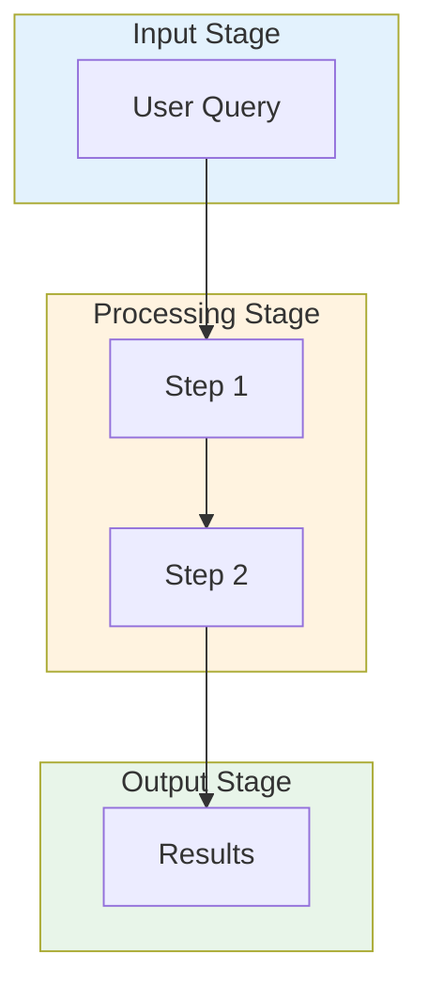
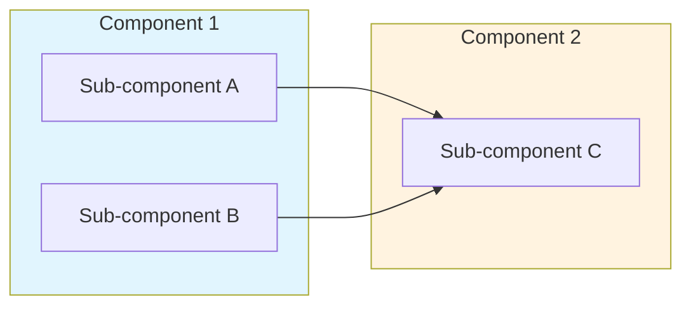
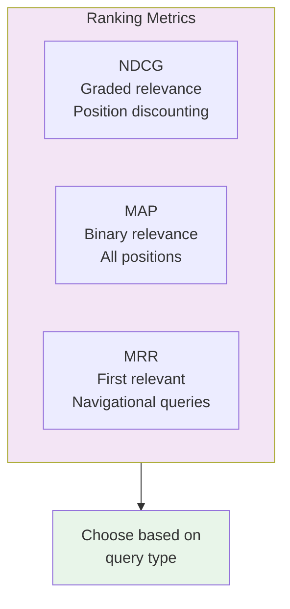
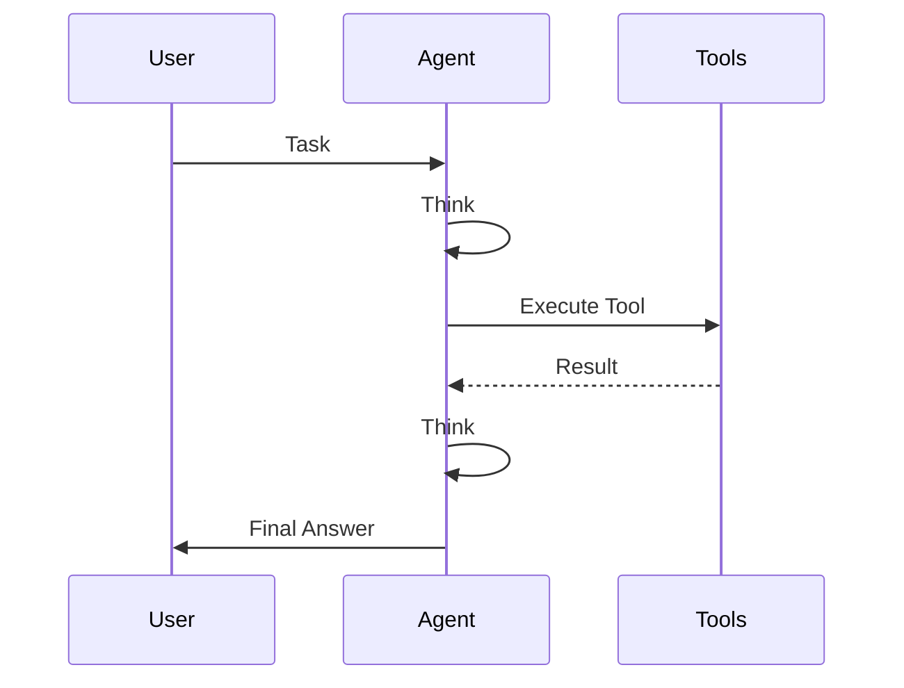
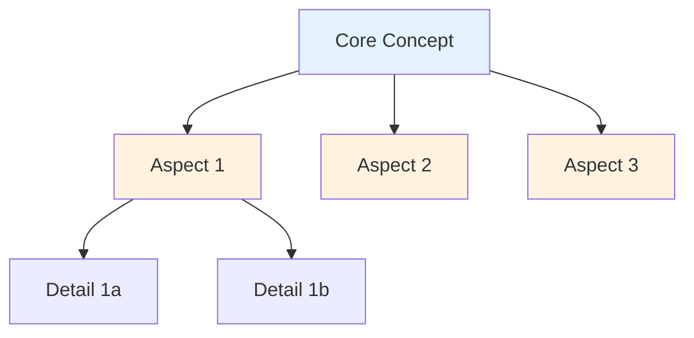

# Hooks and Diagrams Implementation Plan

## Posts Needing Hooks

Based on my review, these posts need more compelling opening hooks:

1. **evaluation-metrics-for-ranking.md** - Currently starts with a question but could be more engaging
2. **rag-retrieval-augmented-generation.md** - Very direct, no hook
3. **agentic-ai.md** - Very direct, no hook  
4. **lifetime-value-estimation.md** - Has questions but could be more compelling
5. **ab-testing-statistics.md** - Very direct, no hook

---

## Proposed Hooks

### 1. Evaluation Metrics for Ranking
**Current:** "How do you know if your ranking model is good?"

**Proposed Hook:**
> In 2009, Microsoft researchers published a paper showing that improving NDCG@10 by just 0.01 could increase revenue by millions of dollars. Yet many ML engineers optimize for accuracy or AUC—metrics that don't measure what actually matters in ranking systems.
>
> Ranking isn't classification. Users care about order, not probabilities. The first result matters more than the tenth. And relevance isn't binary—some results are perfect, others are just okay.
>
> This post explains why NDCG, MAP, and MRR exist, when to use each, and how choosing the wrong metric can make your model worse at what actually matters.

### 2. RAG (Retrieval-Augmented Generation)
**Current:** Very direct definition

**Proposed Hook:**
> In 2023, ChatGPT confidently told a user that the 2024 Olympics were canceled—because its training data cut off in 2021. LLMs are brilliant, but they're frozen in time, prone to hallucination, and can't access your private data.
>
> Retrieval-Augmented Generation (RAG) solves all three problems by grounding LLM responses in retrieved documents. Instead of relying on what the model memorized, RAG retrieves current, relevant information and generates answers from that evidence.
>
> This architecture has become the standard for knowledge-intensive applications—from customer support to legal research to internal knowledge bases. Here's how it works and how to build it.

### 3. Agentic AI
**Current:** Very direct definition

**Proposed Hook:**
> In 2023, an AI agent autonomously completed a software engineering task that would have taken a human hours—writing code, running tests, fixing bugs, and iterating until it worked. This wasn't science fiction; it was AutoGPT, one of the first agentic AI systems to capture public imagination.
>
> Agentic AI represents a paradigm shift: from single-turn Q&A to autonomous systems that plan, execute tools, and iterate toward goals. These agents combine LLM reasoning with code execution, web search, API calls, and feedback loops.
>
> From coding assistants to research agents to customer service automation, agentic systems are the next wave of AI applications. This post covers how to build them.

### 4. Lifetime Value Estimation
**Current:** Starts with questions

**Proposed Hook:**
> Netflix spends an average of $30-40 to acquire each subscriber. How do they know that's profitable? They predict Customer Lifetime Value (LTV)—the total revenue a customer will generate over their entire relationship.
>
> LTV prediction transforms business decisions: acquisition budgets, customer segmentation, retention strategies, and resource allocation all depend on understanding customer value. A customer worth $500 over their lifetime justifies different spending than one worth $50.
>
> This post covers probabilistic models, ML approaches, and practical strategies for predicting LTV—the metric that guides billion-dollar acquisition decisions.

### 5. A/B Testing Statistics
**Current:** Very direct definition

**Proposed Hook:**
> In 2012, Google ran over 7,000 A/B tests. By 2020, that number exceeded 100,000 per year. A/B testing is the backbone of data-driven decision making—but most experiments are run incorrectly.
>
> P-hacking, underpowered tests, and multiple comparison problems plague naively run experiments. A poorly designed test can confidently tell you a feature improved conversion when it actually made things worse.
>
> This primer covers the statistical foundations every experimentation practitioner needs: power analysis, multiple testing corrections, variance reduction, and how to avoid the traps that lead to false conclusions.

---

## Diagram Style Recommendations

Based on your existing posts (game theory, AI overview, information retrieval), I see you use **Mermaid diagrams** effectively. Here are style recommendations:

### Style 1: Flowcharts (for processes)
**Best for:** RAG pipeline, Agent loop, A/B testing workflow, Evaluation pipeline

**Example Style:**

**Use for:**
- RAG: Query → Retrieval → Context → Generation
- Agentic AI: Observe → Think → Act → Observe loop
- A/B Testing: Design → Randomize → Collect → Analyze
- Evaluation: Predictions → Metrics → Interpretation

### Style 2: Architecture Diagrams (for systems)
**Best for:** RAG architecture, Agent architecture, Ranking system architecture

**Example Style:**

**Use for:**
- RAG: Retriever, Document Store, Generator components
- Agentic AI: LLM, Tools, Memory, Planning components
- Ranking: Feature extraction, Model, Reranking stages

### Style 3: Comparison Tables/Matrices
**Best for:** Metric comparisons, Method comparisons, Trade-offs

**Example Style:**

**Use for:**
- Evaluation metrics: When to use NDCG vs MAP vs MRR
- RAG methods: Dense vs Sparse vs Hybrid retrieval
- Agent architectures: ReAct vs Plan-and-Execute

### Style 4: Sequence Diagrams (for interactions)
**Best for:** Agent loops, Multi-step processes, User interactions

**Example Style:**

**Use for:**
- Agentic AI: The observe-think-act loop
- RAG: Query → Retrieve → Generate flow
- A/B Testing: User → Randomization → Treatment → Outcome

### Style 5: Conceptual Diagrams (for relationships)
**Best for:** Metric relationships, Causal relationships, Hierarchies

**Example Style:**

**Use for:**
- Evaluation metrics: How metrics relate to each other
- LTV components: Frequency, Monetary, Retention relationships
- Ad tech metrics: How eCPM, ROAS, CPC relate

---

## Specific Diagram Recommendations by Post

### 1. Evaluation Metrics for Ranking
- **Flowchart**: Ranking evaluation pipeline (predictions → metrics → interpretation)
- **Comparison diagram**: When to use which metric (NDCG vs MAP vs MRR decision tree)
- **Conceptual**: How position discounting works visually

### 2. RAG
- **Architecture**: RAG system components (Retriever, Document Store, Generator)
- **Flowchart**: RAG pipeline (Query → Retrieve → Context → Generate)
- **Comparison**: Dense vs Sparse vs Hybrid retrieval trade-offs

### 3. Agentic AI
- **Sequence diagram**: Agent loop (Observe → Think → Act → Observe)
- **Architecture**: Agent components (LLM, Tools, Memory, Planning)
- **Flowchart**: ReAct vs Plan-and-Execute comparison

### 4. Lifetime Value Estimation
- **Conceptual**: LTV components (Frequency, Monetary, Retention)
- **Flowchart**: RFM analysis process
- **Architecture**: BG/NBD + Gamma-Gamma model flow

### 5. A/B Testing Statistics
- **Flowchart**: A/B testing workflow (Design → Randomize → Collect → Analyze)
- **Conceptual**: Multiple testing problem visualization
- **Comparison**: Power analysis trade-offs (sample size vs effect size)

---

## Color Scheme Recommendations

Based on your existing diagrams, I recommend:

- **Input/Query stages**: `#e3f2fd` (light blue)
- **Processing/Computation**: `#fff3e0` (light orange)
- **Output/Results**: `#e8f5e9` (light green)
- **Decision/Comparison**: `#f3e5f5` (light purple)
- **Warning/Important**: `#fce4ec` (light pink)

This maintains consistency with your existing style while providing visual distinction.

---

## Implementation Order

1. **Add hooks** to all 5 posts (quick wins)
2. **Add diagrams** starting with:
   - RAG architecture (most impactful)
   - Agent loop sequence diagram
   - Evaluation metrics comparison
   - A/B testing workflow
   - LTV components

Would you like me to proceed with these styles, or would you prefer different approaches?
