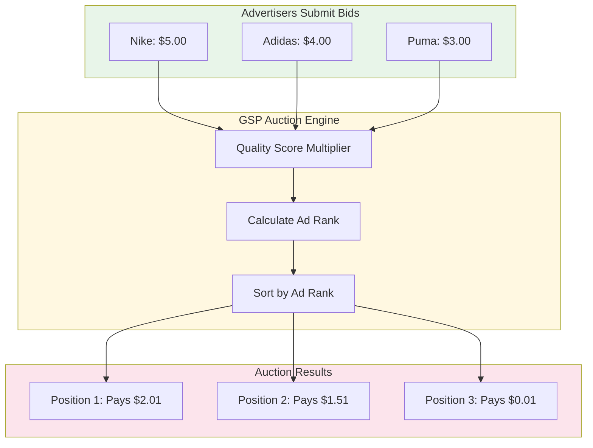
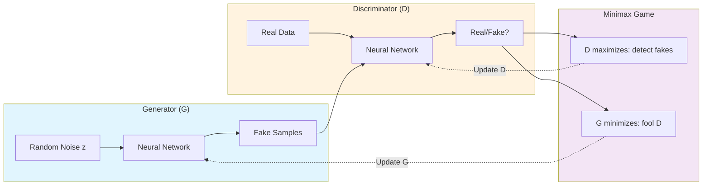

> *"Real life consists of bluffing, of little tactics of deception, of asking yourself what is the other man going to think I mean to do. And that is what games are about in my theory."*
> — **John von Neumann**, founder of game theory

On May 11, 1997, the world watched as Garry Kasparov—widely considered the greatest chess player in history—slumped in his chair, resigned, and walked off the stage. IBM's Deep Blue had just defeated the world champion in a six-game match. The machine had learned to think strategically.

Nearly two decades later, in March 2016, an even more stunning moment unfolded in Seoul. DeepMind's AlphaGo faced Lee Sedol, an 18-time world champion in the ancient game of Go—a game with more possible positions than atoms in the observable universe. After AlphaGo's victory, Demis Hassabis, DeepMind's CEO, was asked about the significance. His response was simple but profound: *"This is not a loss for humanity. This is a win."*

The connective tissue between these milestones is *not* brute-force search. It's the evolution of strategic reasoning: from exact minimax in small games, to statistical search, to learned policies that anticipate an opponent's intent.

What connects these watershed moments? **Game theory**—the mathematical framework for understanding strategic decision-making. This chapter-based exploration takes you from the theoretical foundations laid by brilliant minds in the 1940s to the adversarial neural networks and ad auction systems powering today's trillion-dollar tech industry.

---

## Chapter I: Why Machines Must Think Strategically

### The Essence of Strategic Reasoning

Consider a scenario familiar to any ML engineer working on recommendations or ads: you're designing an algorithm to bid on ad placements. Your algorithm doesn't operate in isolation—it competes against other algorithms, each trying to maximize their own objectives. If you bid too high, you waste budget. Too low, and you lose valuable impressions to competitors.

This is the heart of game theory: situations where the optimal action depends on what others do. Unlike classical optimization, where you maximize an objective against a static environment, strategic settings require you to anticipate, adapt, and sometimes deceive.

### From Parlor Games to Production Systems

John von Neumann's interest in game theory began not with economics but with poker. He found it fascinating that poker required skills absent from chess: the art of the bluff, the ability to mislead while reading others' intentions. In 1928, he published his minimax theorem, proving that in two-player zero-sum games, there exists an optimal strategy that guarantees the best worst-case outcome.

This insight has profound implications for ML systems:

- **Adversarial robustness**: Your classifier faces attackers who adapt to your defenses
- **Auction systems**: Your bidding algorithm competes against other optimization algorithms
- **Multi-agent RL**: Your agent must coordinate or compete with other learning agents
- **GANs**: Your generator must fool a discriminator that's simultaneously learning to detect fakes

Game theory provides the mathematical language to reason about all these scenarios.

---

## Chapter II: The Mathematics of Equilibrium

### Nash Equilibrium: When No One Wants to Deviate

The central concept in game theory is the **Nash Equilibrium**, named after mathematician John Nash (whose life was dramatized in *A Beautiful Mind*). A Nash Equilibrium is a strategy profile where no player can improve their outcome by unilaterally changing their strategy.

Formally, for a game with players $i \in \{1, ..., n\}$, strategy sets $S_i$, and utility functions $u_i$, a strategy profile $s^* = (s_1^*, ..., s_n^*)$ is a Nash Equilibrium if:

$$u_i(s_i^*, s_{-i}^*) \geq u_i(s_i, s_{-i}^*) \quad \forall s_i \in S_i, \forall i$$

Here, $s_{-i}^*$ denotes the strategies of all players except $i$. The key insight: at equilibrium, everyone is playing their best response to everyone else's strategy.

**Nash's theorem (1950)**: Every finite game has at least one Nash Equilibrium, possibly in mixed strategies (probability distributions over actions).

### The Minimax Theorem for Zero-Sum Games

For two-player zero-sum games—where one player's gain is the other's loss—von Neumann proved something even stronger:

$$\max_{s_1} \min_{s_2} u_1(s_1, s_2) = \min_{s_2} \max_{s_1} u_1(s_1, s_2) = v^*$$

This **minimax theorem** guarantees that both players can secure a value $v^*$ regardless of the opponent's strategy. In chess, this means theoretically optimal play exists (though the game tree is too large to compute it).

### Why This Matters for ML

Understanding equilibrium concepts helps ML practitioners:

1. **GANs**: Training seeks a Nash Equilibrium where the generator produces realistic samples and the discriminator achieves 50% accuracy (can't distinguish real from fake)
2. **Multi-agent RL**: Convergence to equilibrium indicates stable learned policies
3. **Mechanism design**: Designing auctions where truthful bidding is an equilibrium strategy

---

## Chapter III: From Theory to Algorithms

### The Minimax Algorithm

The minimax algorithm, developed for perfect-information games like chess, builds a game tree and evaluates positions recursively:

```python
import math
from typing import Optional, List, Tuple
from dataclasses import dataclass

@dataclass
class GameState:
    """Represents a game state with methods for tree traversal."""
    position: any

    def is_terminal(self) -> bool:
        """Check if this is an end state (win/loss/draw)."""
        raise NotImplementedError

    def evaluate(self) -> float:
        """Static evaluation of position (-inf to +inf, positive favors maximizer)."""
        raise NotImplementedError

    def get_moves(self) -> List['GameState']:
        """Generate all legal successor states."""
        raise NotImplementedError


def minimax_alpha_beta(
    state: GameState,
    depth: int,
    alpha: float,
    beta: float,
    maximizing: bool
) -> Tuple[float, Optional[GameState]]:
    """
    Minimax with Alpha-Beta pruning.

    The key insight: if we've found a move that guarantees value X for the maximizer,
    we can prune any subtree where the minimizer can force a value <= X.

    This reduces effective branching factor from b to ~√b, enabling
    twice the search depth in the same time.

    Args:
        state: Current game state
        depth: Remaining search depth
        alpha: Best guaranteed value for maximizer (starts at -∞)
        beta: Best guaranteed value for minimizer (starts at +∞)
        maximizing: True if it's the maximizer's turn

    Returns:
        (evaluation, best_move) tuple
    """
    if depth == 0 or state.is_terminal():
        return state.evaluate(), None

    best_move = None

    if maximizing:
        max_eval = -math.inf
        for child in state.get_moves():
            eval_score, _ = minimax_alpha_beta(child, depth - 1, alpha, beta, False)
            if eval_score > max_eval:
                max_eval = eval_score
                best_move = child
            alpha = max(alpha, eval_score)
            if beta <= alpha:
                break  # Beta cutoff - minimizer won't allow this path
        return max_eval, best_move
    else:
        min_eval = math.inf
        for child in state.get_moves():
            eval_score, _ = minimax_alpha_beta(child, depth - 1, alpha, beta, True)
            if eval_score < min_eval:
                min_eval = eval_score
                best_move = child
            beta = min(beta, eval_score)
            if beta <= alpha:
                break  # Alpha cutoff - maximizer won't allow this path
        return min_eval, best_move


# Example usage for a simple game
class TicTacToeState(GameState):
    """Tic-tac-toe implementation for demonstration."""

    def __init__(self, board: List[str] = None, player: str = 'X'):
        self.board = board or [' '] * 9
        self.player = player

    def is_terminal(self) -> bool:
        return self._check_winner() is not None or ' ' not in self.board

    def _check_winner(self) -> Optional[str]:
        lines = [(0,1,2), (3,4,5), (6,7,8),  # rows
                 (0,3,6), (1,4,7), (2,5,8),  # cols
                 (0,4,8), (2,4,6)]            # diagonals
        for a, b, c in lines:
            if self.board[a] == self.board[b] == self.board[c] != ' ':
                return self.board[a]
        return None

    def evaluate(self) -> float:
        winner = self._check_winner()
        if winner == 'X': return 1.0
        if winner == 'O': return -1.0
        return 0.0

    def get_moves(self) -> List['TicTacToeState']:
        moves = []
        next_player = 'O' if self.player == 'X' else 'X'
        for i, cell in enumerate(self.board):
            if cell == ' ':
                new_board = self.board.copy()
                new_board[i] = self.player
                moves.append(TicTacToeState(new_board, next_player))
        return moves
```

### Counterfactual Regret Minimization (CFR)

While minimax works beautifully for perfect-information games, real-world strategic scenarios often involve **hidden information**. Poker, for instance, requires reasoning about what cards opponents *might* hold.

**Counterfactual Regret Minimization (CFR)**, developed by Zinkevich et al. at the University of Alberta, revolutionized imperfect-information game solving. The algorithm:

1. **Self-play**: The agent plays against itself repeatedly
2. **Regret tracking**: For each decision point, track how much the agent "regrets" not choosing each action
3. **Strategy update**: Shift probability toward actions with positive regret

The mathematical core: at each information state $h$, the regret for not taking action $a$ is:

$$R^T(h, a) = \sum_{t=1}^{T} \pi_{-i}^{\sigma^t}(h) \cdot (u_i(\sigma^t|_{h \to a}) - u_i(\sigma^t))$$

Where $\pi_{-i}$ is the probability of reaching $h$ given opponents' strategies, and $u_i(\sigma^t|_{h \to a})$ is the utility of always choosing action $a$ at state $h$.

**CFR's key result**: As iterations $T \to \infty$, the average strategy converges to a Nash Equilibrium.

This algorithm powered **Libratus** (2017) and **Pluribus** (2019), AI systems that achieved superhuman performance in heads-up no-limit Texas Hold'em and 6-player poker respectively—feats previously thought impossible due to the game's complexity.

---

## Chapter IV: Game Theory in Production ML Systems

### Case Study: Ad Auction Mechanisms

Every day, trillions of ad auctions run across Google, Meta, Amazon, and other platforms. These systems are masterclasses in applied game theory.

#### Google's Search Ads Auction: A GSP-Style Mechanism

When you search on Google, advertisers compete in a search ads auction. In simplified form:

1. Advertisers submit bids for keywords
2. Ads are ranked by **Ad Rank**, which incorporates bid and quality signals
3. Winners pay the *minimum amount needed to maintain their position* based on the next ad's Ad Rank thresholds

This is closely related to the **Generalized Second-Price (GSP)** auction studied in the literature, and it carries the same core strategic lesson: **truthful bidding is not a dominant strategy**. Bidders can benefit from shading or pacing depending on how they model competition and budget constraints.



#### The Production Reality: Multi-Objective Auctions

In production, ad auctions rarely optimize a single number. They blend bids with quality, predicted engagement, and long-term platform health. That moves the system away from textbook equilibria and toward **learning in games**: your model adapts, other bidders adapt back, and the equilibrium shifts over time.

```python
class AdAuctionSimulator:
    """
    Simulate different auction mechanisms.

    Demonstrates why auction design affects bidding strategy.
    """

    @staticmethod
    def gsp_auction(bids: dict, quality_scores: dict) -> dict:
        """
        Generalized Second-Price auction (Google-style).

        Returns dict mapping advertiser -> (position, payment)
        """
        # Calculate ad ranks
        ad_ranks = {adv: bids[adv] * quality_scores[adv]
                   for adv in bids}

        # Sort by ad rank (descending)
        ranking = sorted(ad_ranks.keys(),
                        key=lambda x: ad_ranks[x],
                        reverse=True)

        results = {}
        for pos, adv in enumerate(ranking):
            # Pay minimum to beat next advertiser
            if pos + 1 < len(ranking):
                next_adv = ranking[pos + 1]
                min_bid_to_win = (ad_ranks[next_adv] / quality_scores[adv]) + 0.01
                payment = min(bids[adv], min_bid_to_win)
            else:
                payment = 0.01  # Minimum payment for last position

            results[adv] = {'position': pos + 1, 'payment': payment}

        return results

    @staticmethod
    def vcg_auction(bids: dict, values_per_impression: dict) -> dict:
        """
        VCG auction (Meta-style simplified).

        Payment = harm you cause to others by winning
        """
        # Calculate total welfare with and without each advertiser
        total_value = sum(bids.values())

        results = {}
        sorted_advs = sorted(bids.keys(), key=lambda x: bids[x], reverse=True)

        for i, adv in enumerate(sorted_advs):
            # Value of system without this advertiser getting a slot
            value_without = sum(bids[a] for a in sorted_advs if a != adv)

            # VCG payment: externality imposed on others
            if i < len(sorted_advs) - 1:
                # Bump next advertiser up
                displaced_value = bids[sorted_advs[i + 1]] if i + 1 < len(sorted_advs) else 0
                vcg_payment = displaced_value
            else:
                vcg_payment = 0

            results[adv] = {'position': i + 1, 'vcg_payment': vcg_payment}

        return results


# Demonstration
bids = {'Nike': 5.00, 'Adidas': 4.00, 'Puma': 3.00}
quality = {'Nike': 0.8, 'Adidas': 1.0, 'Puma': 0.9}

print("GSP Results:", AdAuctionSimulator.gsp_auction(bids, quality))
```

### Case Study: GANs as Two-Player Games

Ian Goodfellow's **Generative Adversarial Networks** (2014) formalized generative modeling as a game:

- **Generator (G)**: Produces fake samples to fool the discriminator
- **Discriminator (D)**: Classifies samples as real or fake

The training objective is a minimax game:

$$\min_G \max_D \mathbb{E}_{x \sim p_{data}}[\log D(x)] + \mathbb{E}_{z \sim p_z}[\log(1 - D(G(z)))]$$



**The goal**: Reach Nash Equilibrium where $G$ produces samples indistinguishable from real data, and $D$ outputs 0.5 for all samples.

**Training challenges from a game-theoretic lens**:

| Problem | Game Theory Interpretation |
|---------|---------------------------|
| Mode collapse | Generator finds exploitative strategy against current discriminator |
| Oscillation | Gradient updates cause cycling rather than convergence |
| Vanishing gradients | Discriminator wins too decisively; generator receives no learning signal |

Understanding GAN training as game dynamics has led to innovations like **Wasserstein GANs** and **spectral normalization**, which stabilize the game.

---

## Chapter V: DeepMind's Game-Playing Breakthroughs

### AlphaGo: Monte Carlo Tree Search Meets Deep Learning

In March 2016, AlphaGo made history. Demis Hassabis described the game of Go as *"a bit of a holy grail for AI research"*—with $10^{170}$ possible board positions (dwarfing chess's $10^{47}$), brute-force search was impossible.

AlphaGo combined:

1. **Policy network**: Predicts good moves (trained on human expert games, then self-play)
2. **Value network**: Estimates probability of winning from a position
3. **Monte Carlo Tree Search (MCTS)**: Uses networks to guide strategic exploration

The game-theoretic insight: rather than computing a full minimax tree (impossible for Go), AlphaGo uses learned value estimates to approximate optimal play.

### AlphaZero: Tabula Rasa Learning

AlphaZero (2017) went further: starting with only the rules, it learned Chess, Shogi, and Go through pure self-play reinforcement learning. After just 4 hours of training, it defeated the world's strongest chess engine (Stockfish).

The approach:
- No human knowledge (except rules)
- Self-play generates training data
- Policy and value networks guide MCTS
- The agent learns to approximate optimal minimax play through experience

### Pluribus and Poker: Mastering Imperfect Information

Most real-world strategic scenarios involve hidden information. **Pluribus** (Noam Brown & Tuomas Sandholm, 2019) achieved superhuman performance in 6-player no-limit Texas Hold'em—the first AI to beat top professionals in a multiplayer poker variant.

Key innovations:
- **Depth-limited search** with learned value functions (like AlphaGo)
- **CFR for abstracted game** to find baseline strategy
- **Real-time search** that adapts to opponents' actual play

The game-theoretic achievement: Pluribus finds approximately Nash Equilibrium strategies in games with $10^{164}$ decision points.

---

## Chapter VI: Advanced Topics and Research Frontiers

### Mean Field Game Theory

When games involve *many* players (thousands of autonomous vehicles, millions of market participants), classical game theory becomes intractable. **Mean Field Game Theory** handles this by approximating the aggregate behavior of the population:

Instead of tracking individual players, model:
$$\frac{\partial \rho}{\partial t} + \nabla \cdot (\rho v) = 0$$

Where $\rho$ is the distribution of agents and $v$ is their velocity field.

**Applications**: Traffic flow, epidemic modeling, market dynamics, multi-robot coordination.

### Learning in Games

**Multi-Agent Reinforcement Learning (MARL)** studies how multiple learning agents interact:

| Approach | Description |
|----------|-------------|
| Independent Q-learning | Each agent learns independently (ignores others) |
| Centralized training | Global critic with decentralized execution |
| Communication learning | Agents learn to share information |
| Opponent modeling | Explicitly model other agents' policies |

**Challenge**: Unlike single-agent RL, convergence guarantees are limited. Agents may cycle forever without reaching equilibrium.

### Mechanism Design: Inverse Game Theory

Instead of analyzing existing games, **mechanism design** asks: how should we design the rules to achieve desired outcomes?

**Classic results**:
- **Revelation principle**: Any mechanism can be converted to one where truthful reporting is optimal
- **Gibbard-Satterthwaite theorem**: No voting system with 3+ outcomes is both strategy-proof and non-dictatorial

**ML applications**:
- Designing incentive-compatible recommendation systems
- Auction mechanisms for compute allocation
- Federated learning with strategic participants

---

## Chapter VII: Lessons for the Applied ML Practitioner

### When to Apply Game Theory

Game-theoretic thinking is essential when:

✅ Your system interacts with other optimizing agents (competitors, users, attackers)
✅ Your model will be deployed against adversarial actors
✅ You're designing mechanisms (auctions, matching systems, resource allocation)
✅ You're training GANs or multi-agent systems

### Practical Design Principles

1. **Anticipate strategic behavior**: Users and competitors will optimize against your system. A fraud model's false negatives will be exploited; an ad algorithm's bid logic will be reverse-engineered.

2. **Design for equilibrium properties**: When possible, create mechanisms where desired behavior is an equilibrium (like VCG's truthfulness).

3. **Consider bounded rationality**: Real agents aren't perfectly rational. Sometimes exploitative strategies beat equilibrium strategies.

4. **Monitor for gaming**: Track metrics for signs that users are gaming your system. A/B tests can miss strategic adaptation that occurs after full deployment.

### The Road Ahead

Game theory in AI is accelerating. Recent developments include:

- **DeepNash** (2022): Mastered Stratego, learning to bluff without any human data
- **Cicero** (2022): Combined language models with game theory for Diplomacy
- **Constitutional AI**: Game-theoretic approaches to AI alignment

Recent research shows the frontier is no longer just perfect-information games. **DeepNash** (2022) learned to bluff in Stratego without human data, and **Cicero** (2022) combined game theory and language modeling to play Diplomacy at a high level—both milestones in *strategic interaction under uncertainty and communication*.

As Demis Hassabis noted: *"Step one, solve intelligence; step two, use it to solve everything else."*

Game theory provides foundational tools for step one—and step two requires understanding how intelligent systems interact strategically.

---

## References and Further Exploration

### Foundational Texts
- von Neumann & Morgenstern, *Theory of Games and Economic Behavior* (1944) — The founding document
- Shoham & Leyton-Brown, *Multiagent Systems* (free online) — Comprehensive modern treatment
- Nisan et al., *Algorithmic Game Theory* — Bridge between CS and economics

### Seminal Papers
- Nash, "Equilibrium Points in N-Person Games" (1950) — [PNAS](https://www.pnas.org/doi/10.1073/pnas.36.1.48)
- Zinkevich et al., "Regret Minimization in Games with Incomplete Information" (2007) — CFR introduction
- Goodfellow et al., "Generative Adversarial Networks" (2014) — [arXiv](https://arxiv.org/abs/1406.2661)
- Silver et al., "Mastering the Game of Go with Deep Neural Networks and Tree Search" (2016) — [Nature](https://www.nature.com/articles/nature16961)
- Brown et al., "Superhuman AI for heads-up no-limit poker" (2017) — [IJCAI](https://www.ijcai.org/proceedings/2017/392)
- Brown & Sandholm, "Superhuman AI for Multiplayer Poker" (2019) — [Science](https://www.science.org/doi/10.1126/science.aay2400)
- Perolat et al., "Mastering the game of Stratego with model-free multiagent RL" (2022) — [Science](https://pubmed.ncbi.nlm.nih.gov/36099210/)
- Meta AI, "Human-level play in Diplomacy by combining language models and game theory" (2022) — [Science](https://www.science.org/doi/10.1126/science.ade9097)

### Applied Deep Dives
- Edelman, Ostrovsky & Schwarz, "Internet Advertising and the Generalized Second-Price Auction" (2007) — [GSP analysis](https://academic.oup.com/qje/article/122/1/75/1922488)
- Google Ads Help, "How the Google Ads auction works" — [Ad Rank and pricing basics](https://support.google.com/google-ads/answer/6304)
- Bowling et al., "Heads-up Limit Hold'em Poker is Solved" (Science, 2015) — CFR triumph

---

*The game is never truly over. Every deployed ML system enters a strategic landscape populated by users, competitors, and adversaries—all optimizing their own objectives. By understanding game theory, we learn to see our models not as static artifacts but as players in an ongoing, dynamic game. And in that game, the best strategy is often to keep learning.*
