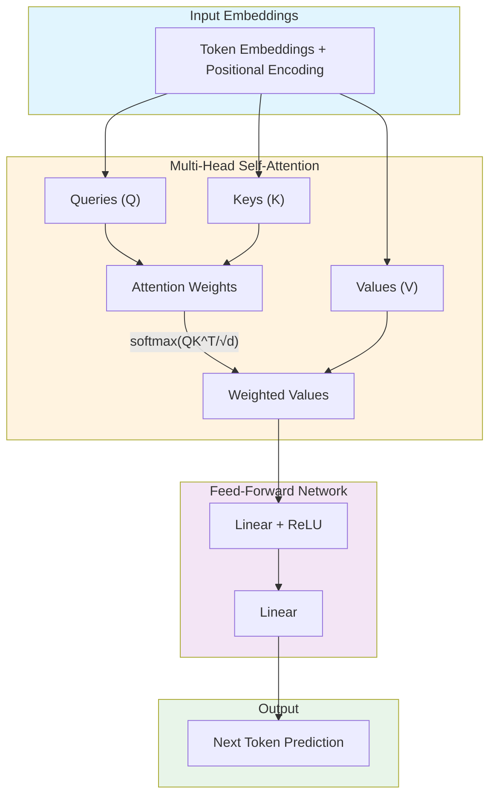

> *"I believe that at the end of the century the use of words and general educated opinion will have altered so much that one will be able to speak of machines thinking without expecting to be contradicted."*
> — **Alan Turing**, "Computing Machinery and Intelligence" (1950)

Turing's prediction, written in 1950, was precisely right—just a few decades off. By the 2020s, transformer-based systems generate fluent text, write code, and synthesize images with startling coherence. Machines, in ways that matter, think.

> **Related reading**: Strategic interaction underpins many AI milestones—see [The Art of Strategic Machines](/posts/musings-on-game-theory/).

But what does it mean for a machine to think? Where did this capability come from? And where might it lead?

This exploration traces AI's journey from abstract logic machines to systems that seem genuinely intelligent—a story of breakthrough insights, crushing disappointments, and the slow accumulation of ideas that, together, changed everything.

---

## Chapter I: The Dream of Thinking Machines

### Turing's Imitation Game

It began with a question: *Can machines think?*

In 1950, Alan Turing—mathematician, cryptographer, and architect of the first programmable computers—published "Computing Machinery and Intelligence" in the journal *Mind*. Rather than philosophizing about consciousness, Turing proposed a test: if a human interrogator, communicating via text, cannot reliably distinguish a machine from a person, we should consider the machine intelligent.

The genius of Turing's framing was its pragmatism. He wrote:

> *"The original question, 'Can machines think?' I believe to be too meaningless to deserve discussion. Instead, we should ask: can a machine behave intelligently?"*

This operational definition—intelligence as behavior—would define AI research for decades.

### The Dartmouth Conference: AI Gets Its Name

In the summer of 1956, ten researchers gathered at Dartmouth College in Hanover, New Hampshire. Their proposal stated an audacious thesis:

> *"Every aspect of learning or any other feature of intelligence can in principle be so precisely described that a machine can be made to simulate it."*

Among the attendees: John McCarthy (who coined the term "artificial intelligence"), Marvin Minsky, Claude Shannon (inventor of information theory), and Herbert Simon (later a Nobel laureate). Over two months, they laid foundations that persist today: symbolic reasoning, game playing, natural language processing.

The optimism was extraordinary. Simon predicted in 1958: "Within ten years, a computer will be world chess champion" (off by 40 years). McCarthy believed general AI was around the corner (still waiting). This exuberance would cost the field dearly.

---

## Chapter II: The Rise and Fall of Symbolic AI

### Expert Systems and the First Golden Age

Through the 1960s and early 1970s, AI flourished. Early programs achieved remarkable feats:

- **Logic Theorist** (1956): Proved mathematical theorems from Principia Mathematica
- **ELIZA** (1966): Simulated conversation so convincingly that some users believed it understood them
- **SHRDLU** (1972): Manipulated blocks in a virtual world through natural language

The dominant paradigm was **symbolic AI**: intelligence as logical reasoning over explicit representations. Knowledge was encoded as rules: `IF patient has fever AND cough THEN consider pneumonia`. Systems grew increasingly sophisticated: MYCIN diagnosed blood infections; DENDRAL identified chemical structures; XCON configured computer systems.

By 1985, expert systems were a billion-dollar industry. The future seemed clear.

### The AI Winters

Then came the cold.

**The First AI Winter (1974-1980)**: DARPA cut funding after researchers failed to deliver on ambitious promises. The Lighthill Report in the UK concluded that AI had achieved little of practical value. Neural network research, championed by Frank Rosenblatt's Perceptron, was mathematically shown to have severe limitations (Minsky & Papert, 1969).

**The Second AI Winter (1987-1993)**: The expert systems market collapsed. Rule-based systems proved brittle—they failed silently on novel problems, and maintaining thousands of interrelated rules became impossible. As Geoffrey Hinton later noted:

> *"A deep-learning system doesn't have any explanatory power. But neither do expert systems, really—they just hide their lack of explanation behind symbols."*

The lesson was harsh but essential: intelligence couldn't be programmed rule by rule. Something was missing.

### What Was Missing

The symbolic AI dream assumed that intelligence could be captured in explicit, human-readable rules. But consider recognizing a face: you know your mother's face instantly, yet you cannot articulate the rules that distinguish her from seven billion other humans.

Much of intelligence, it turned out, is **subsymbolic**—patterns too subtle to verbalize, learned from experience rather than coded by engineers.

This insight would eventually vindicate the neural network researchers who kept working through the winters.

---

## Chapter III: The Connectionist Revolution

### Neural Networks Return

Through the 1980s and 1990s, a small community kept faith with neural networks. Key breakthroughs accumulated:

**Backpropagation (1986)**: Rumelhart, Hinton, and Williams demonstrated that multi-layer networks could learn complex mappings through gradient descent. The paper *"Learning Representations by Back-Propagating Errors"* would become one of the most cited in AI history.

**Universal Approximation (1989, 1991)**: Theorems by Cybenko and Hornik proved that neural networks with a single hidden layer could approximate any continuous function—a mathematical foundation for their power.

**Convolutional Networks (1989)**: Yann LeCun's work on handwritten digit recognition at Bell Labs introduced convolutions for vision tasks, though hardware limitations prevented scaling.

Yet progress was slow. Training deep networks was unstable; datasets were small; computers were weak. The field survived on faith.

As Ilya Sutskever would later reflect:

> *"One doesn't bet against deep learning. Somehow, every time you run into an obstacle, within six months or a year researchers find a way around it."*

### The ImageNet Moment

Everything changed in September 2012.

AlexNet—a deep convolutional neural network trained by Alex Krizhevsky, Ilya Sutskever, and Geoffrey Hinton—won the ImageNet competition with a top-5 error rate of 15.3%. The second-best entry achieved 26.2%. It wasn't a marginal improvement; it was a demolition.

The key ingredients:
- **Depth**: Eight layers, vastly deeper than previous networks
- **GPUs**: Training on NVIDIA graphics cards made computation feasible
- **Data**: ImageNet provided millions of labeled images
- **Techniques**: Dropout for regularization, ReLU activations for faster training

The ImageNet moment established three principles that would drive the next decade:
1. **Scale matters**: Bigger models, more data, more compute
2. **End-to-end learning**: Let the network learn features automatically
3. **GPUs unlock deep learning**: Hardware was a bottleneck, not algorithms

---

## Chapter IV: The Mathematical Foundations

### Learning as Optimization

At its heart, modern deep learning is optimization. We seek parameters $\theta$ that minimize a loss function over a dataset:

$$\theta^* = \arg\min_\theta \frac{1}{n} \sum_{i=1}^{n} L(f_\theta(x_i), y_i)$$

where $f_\theta$ is the neural network, $(x_i, y_i)$ are input-output pairs, and $L$ is a loss (cross-entropy for classification, MSE for regression).

**Backpropagation** makes this tractable by efficiently computing gradients via the chain rule:

$$\frac{\partial L}{\partial \theta} = \frac{\partial L}{\partial a_L} \cdot \frac{\partial a_L}{\partial a_{L-1}} \cdots \frac{\partial a_1}{\partial \theta}$$

Each partial derivative flows backward through layers, enabling optimization of networks with billions of parameters.

### Scaling Laws: The Empirical Science of Deep Learning

In 2020, OpenAI published a landmark paper revealing **scaling laws**: predictable relationships between model size, dataset size, compute, and performance:

$$L(N, D, C) = \left(\frac{N_c}{N}\right)^{\alpha_N} + \left(\frac{D_c}{D}\right)^{\alpha_D}$$

where $L$ is loss, $N$ is parameters, $D$ is data tokens, and $\alpha$ values are empirical exponents (~0.076 for parameters, ~0.095 for data).

The implication was profound: **performance improves predictably with scale**. Double your compute budget, and loss decreases by a known amount. This turned AI research into something resembling engineering—you could plan investments with confidence.

These laws also revealed that models should scale roughly proportionally—more parameters require more data, and vice versa.

### Emergence: When More Is Different

Perhaps the most striking phenomenon in large language models is **emergence**: capabilities that appear suddenly at scale.

- GPT-2 (1.5B parameters): Generates coherent paragraphs
- GPT-3 (175B parameters): Performs few-shot learning, writes code
- GPT-4 (estimated 1.8T parameters): Passes bar exams, reasons multi-step

These capabilities weren't explicitly trained; they emerged from the optimization process itself. As Yann LeCun observed:

> *"AI is going to bring a new renaissance for humanity, a new form of enlightenment, because AI is going to amplify everybody's intelligence."*

Yet emergence also creates risks—capabilities we don't anticipate and can't fully control.

---

## Chapter V: The Transformer Era

### Attention Is All You Need

In 2017, a team at Google published *"Attention Is All You Need"*, introducing the **Transformer architecture**. Unlike RNNs, which process sequences step by step, Transformers use **self-attention** to relate all positions simultaneously:

$$\text{Attention}(Q, K, V) = \text{softmax}\left(\frac{QK^T}{\sqrt{d_k}}\right)V$$

where queries ($Q$), keys ($K$), and values ($V$) are learned projections of input embeddings.

The architecture enabled:
- **Parallelization**: All tokens processed simultaneously (unlike sequential RNNs)
- **Long-range dependencies**: Attention spans entire sequences
- **Scalability**: Simple to scale to billions of parameters



### The LLM Explosion

Building on Transformers, language models grew exponentially:

| Year | Model | Parameters | Key Capability |
|------|-------|------------|----------------|
| 2018 | BERT | 340M | Bidirectional pretraining |
| 2020 | GPT-3 | 175B | Few-shot learning |
| 2023 | GPT-4 | Not disclosed | Reasoning and multimodal variants |
| 2024 | Claude 3 | Not disclosed | Long-context, safety-aligned |
| 2024 | Gemini 1.5 | Not disclosed | Long-context, multimodal |
| 2024 | Llama 3 | 8B / 70B | Strong open-weight baselines |

Most modern pipelines follow a **pretrain-then-adapt** pattern: learn general language representations at scale, then specialize with task data and preference signals.

### The Practitioner's View

For applied ML engineers, the LLM era changed everything:

```python
from transformers import pipeline, AutoModelForCausalLM, AutoTokenizer
import torch

# Modern paradigm: few-shot prompting replaces feature engineering
classifier = pipeline("text-classification", model="distilbert-base-uncased")

# 2000s approach: months of feature engineering
# features = [
#     extract_pos_tags(text),
#     count_sentiment_words(text),
#     compute_tf_idf(text),
#     ...
# ]
# model = SVM().fit(features, labels)

# 2020s approach: describe the task, provide examples
summarizer = pipeline("summarization", model="facebook/bart-large-cnn")
result = summarizer("""
    The ImageNet Large Scale Visual Recognition Challenge (ILSVRC)
    uses a subset of ImageNet with roughly 1000 images in each of 1000
    categories. In all, there are roughly 1.2 million training images,
    50,000 validation images, and 150,000 testing images.
""", max_length=50, min_length=25)

print(result[0]['summary_text'])
# Output: ImageNet uses 1.2 million training images across 1000 categories


class EmbeddingBasedClassifier:
    """
    Modern classification: compute embeddings, then simple classifier.

    This approach often outperforms complex feature engineering.
    """

    def __init__(self, model_name="sentence-transformers/all-MiniLM-L6-v2"):
        self.tokenizer = AutoTokenizer.from_pretrained(model_name)
        self.model = AutoModelForCausalLM.from_pretrained(model_name)
        self.classifier = None  # Logistic regression, XGBoost, etc.

    def embed(self, texts):
        """Convert texts to embeddings."""
        encoded = self.tokenizer(
            texts,
            padding=True,
            truncation=True,
            return_tensors="pt"
        )
        with torch.no_grad():
            outputs = self.model(**encoded)
        # Mean pooling over tokens
        return outputs.last_hidden_state.mean(dim=1).numpy()

    def fit(self, texts, labels):
        """Fit classifier on embeddings."""
        from sklearn.linear_model import LogisticRegression
        embeddings = self.embed(texts)
        self.classifier = LogisticRegression().fit(embeddings, labels)
        return self

    def predict(self, texts):
        """Predict using embeddings."""
        embeddings = self.embed(texts)
        return self.classifier.predict(embeddings)
```

---

## Chapter VI: The Road to AGI

### What Is AGI?

**Artificial General Intelligence (AGI)**—sometimes called "strong AI" or "human-level AI"—refers to systems that match human cognitive capabilities across virtually all domains. Unlike narrow AI (excellent at chess, mediocre at poetry), AGI would transfer knowledge freely between tasks.

Definitions of AGI vary. Some emphasize economic capability, others scientific creativity, and others broad task generality. The lack of a universal yardstick is why benchmarks, eval suites, and red-teaming have become central to the field.

### The Scaling Hypothesis

The dominant theory for reaching AGI is the **scaling hypothesis**: continue increasing parameters, data, and compute, and intelligence will emerge.

Evidence in favor:
- GPT-3's few-shot learning (emergent, not explicitly trained)
- Chain-of-thought reasoning in large models
- Multimodal capabilities (vision + language) appearing with scale

Skeptics argue:
- Scaling may hit diminishing returns
- Current architectures may lack essential components (world models, planning)
- Emergence could be a metric artifact, not genuine capability

Geoffrey Hinton captured the optimist's view:

> *"I do believe deep learning is going to be able to do everything, but I do think there's going to have to be quite a few conceptual breakthroughs."*

### The Alignment Problem

As systems approach human-level capability, **alignment** becomes critical: ensuring AI systems pursue intended goals.

The challenge is subtle. A system optimizing for "maximize user engagement" might learn to recommend increasingly extreme content. An AI trained to "be helpful" might agree with harmful requests to seem agreeable.

Current approaches:
- **Preference alignment**: Train models to better match human judgments
- **Constitutional AI** (Anthropic): Encode rules the AI must follow
- **Interpretability**: Understand *why* models make decisions

Ilya Sutskever, before departing OpenAI, emphasized:

> *"It's important for the goals of AI beings to be aligned with human goals. The rate of progress will become extremely fast, resulting in unimaginable things."*

---

## Chapter VII: Navigating the AI Era as a Practitioner

### The New Technical Landscape

For ML engineers entering or navigating this landscape, fundamental truths have shifted:

**Before LLMs (pre-2020)**:
- Success required feature engineering expertise
- Models were trained from scratch for each task
- Deployment was the hard part; training was relatively cheap

**After LLMs (post-2020)**:
- Success requires prompt engineering and fine-tuning
- Foundation models are adapted to tasks
- Training is astronomically expensive; inference is the challenge

### Practical Wisdom for the Practitioner

1. **Start with baselines**: Before fine-tuning a billion-parameter model, try prompting GPT-4. Before prompting, try a simple embedding + classifier.

2. **Understand what's memorized vs. generalized**: LLMs have seen trillions of tokens; your "novel" task may be a retrieval exercise.

3. **Monitor for drift and failures**: AI systems fail silently. Track output distributions, flag low-confidence predictions, build human-in-the-loop workflows.

4. **Take safety seriously**: As Anthropic's researchers note, even "helpful" AI can cause harm. Think adversarially about how your system could be misused.

5. **Stay humble about capabilities**: Current LLMs don't truly "understand" or "reason" in human senses—they predict tokens. Extraordinary benefits coexist with surprising failure modes.

### The Bigger Picture

We stand at an inflection point. AI systems now write code, pass professional exams, and generate plausible scientific hypotheses. The next decade will likely bring:

- **Multimodal generality**: Systems that see, hear, and act
- **Agentic AI**: Systems that pursue goals over extended time horizons
- **Scientific acceleration**: AI-driven discovery in biology, chemistry, physics

Yann LeCun offers a grounding perspective:

> *"Before we reach human-level AI, we will have to reach cat-level AI and dog-level AI."*

We're perhaps at the level of a very well-read parrot with no common sense. The journey continues.

---

## References and Further Exploration

### Foundational Works
- Turing, "Computing Machinery and Intelligence" (1950) — [The founding document](https://academic.oup.com/mind/article/LIX/236/433/986238)
- Russell & Norvig, *AI: A Modern Approach* (4th ed., 2020) — The standard textbook
- Mitchell, *Artificial Intelligence: A Guide for Thinking Humans* — Accessible overview

### Key Papers
- Rumelhart et al., "Learning Representations by Back-Propagating Errors" (1986)
- Krizhevsky et al., "ImageNet Classification with Deep CNNs" (2012) — AlexNet paper
- Vaswani et al., "Attention Is All You Need" (2017) — [Transformer architecture](https://arxiv.org/abs/1706.03762)
- Devlin et al., "BERT: Pre-training of Deep Bidirectional Transformers for Language Understanding" (2018) — [NAACL/ACL Anthology](https://aclanthology.org/N19-1423/)
- Brown et al., "Language Models are Few-Shot Learners" (2020) — [GPT-3](https://arxiv.org/abs/2005.14165)
- Kaplan et al., "Scaling Laws for Neural Language Models" (2020) — [OpenAI scaling laws](https://arxiv.org/abs/2001.08361)
- OpenAI, "GPT-4 Technical Report" (2023) — [arXiv](https://arxiv.org/abs/2303.08774)
- Anthropic, "Claude 3" (2024) — [System Card](https://www.anthropic.com/news/claude-3-family)
- Google DeepMind, "Gemini 1.5" (2024) — [Technical report](https://blog.google/technology/ai/google-gemini-1-5/)
- Meta AI, "Llama 3 Model Card" (2024) — [Model details](https://raw.githubusercontent.com/meta-llama/llama3/main/MODEL_CARD.md)

### On AGI and Alignment
- Bostrom, *Superintelligence* — Philosophical treatment of AGI risks
- Anthropic, "Constitutional AI" (2022) — [Alignment techniques](https://arxiv.org/abs/2212.08073)
- DeepMind, "Levels of AGI" (2023) — Proposed capability taxonomy

### Historical Accounts
- Crevier, *AI: The Tumultuous History of the Search for Artificial Intelligence*
- The 1956 Dartmouth Proposal (available online)

---

*Alan Turing asked whether machines could think. Seventy-five years later, we're still grappling with the question, even as machines write poetry, prove theorems, and beat world champions. Perhaps the answer was never yes or no, but "in what sense, and to what degree?" The arc of machine intelligence is long—and it bends toward the strange, the powerful, and the profoundly uncertain.*
