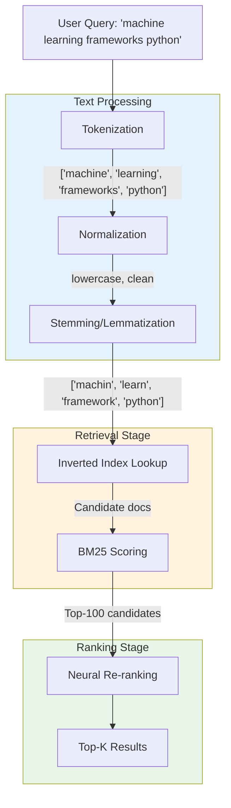
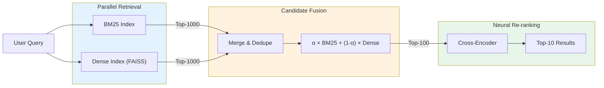
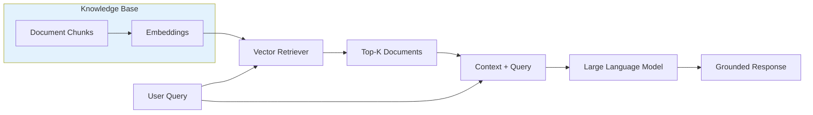

> *"The problem of storing and retrieving information is not new. It is as old as civilization itself."*
> — **Gerard Salton**, pioneer of information retrieval

Every day, you perform information retrieval without thinking about it. You search Google, query a database, ask ChatGPT, or filter your email. Behind each interaction lies a question as old as the Library of Alexandria: *how do we find what we're looking for in a sea of information?*

This question has driven six decades of research, from punch cards to transformers, from exact string matching to semantic understanding. The journey reveals fundamental truths about language, relevance, and the nature of information itself.

> **Related reading**: For the broader AI arc that made neural retrieval possible, see [The Long Arc of Machine Intelligence](/posts/overview-of-artificial-intelligence/).

---

## Chapter I: The Information Explosion and the Birth of a Field

### Before Computers: The Librarian's Problem

In 1945, Vannevar Bush published "As We May Think" in *The Atlantic*, prophesying a "memex"—a device for storing, linking, and retrieving information. Bush foresaw a future drowning in documents: scientific papers, engineering reports, medical records. How would humans cope?

The answer would come from an unlikely place: the technical challenges of library science. Cataloging systems (Dewey Decimal, Library of Congress) had organized books for centuries, but they required human indexers to assign categories. As information volumes exploded, this became untenable.

### The SMART System and Gerard Salton

Gerard Salton, often called the "father of information retrieval," began building the **SMART system** (System for the Mechanical Analysis and Retrieval of Text) at Harvard in the 1960s, continuing at Cornell for three decades. SMART wasn't just a search engine—it was a laboratory for testing ideas.

From SMART emerged concepts that remain foundational:

- **Vector Space Model**: Represent documents and queries as vectors in high-dimensional space
- **TF-IDF weighting**: Balance term frequency against corpus-wide rarity
- **Relevance Feedback**: Use user judgments to improve retrieval
- **Rocchio Classification**: Expand queries based on relevant documents

Salton's insight was profound: *similarity could be computed*. If documents and queries were vectors, relevance became a measurable quantity—the angle between them.

### The Cranfield Paradigm and TREC

But how do you know if a retrieval system is good?

The **Cranfield experiments** (1960s) established the paradigm still used today: create test collections with queries, documents, and human relevance judgments, then measure precision and recall.

The **Text REtrieval Conference (TREC)**, launched by NIST in 1992, industrialized this approach. TREC created massive test collections and standardized evaluation, enabling rigorous comparison of retrieval methods. BM25, learning-to-rank, and dense retrieval were all benchmarked on TREC collections.

As Hal Varian (Google's chief economist) acknowledged: TREC "revitalized information retrieval research" and created the scientific foundations for web search.

---

## Chapter II: The Mathematics of Finding Needles

### TF-IDF: Frequency Meets Rarity

The intuition behind TF-IDF is elegant: important terms appear frequently *in this document* but rarely *across the corpus*.

**Term Frequency (TF)**: How often does term $t$ appear in document $d$?

$$\text{TF}(t, d) = \frac{f_{t,d}}{\sum_{t' \in d} f_{t',d}}$$

**Inverse Document Frequency (IDF)**: How rare is term $t$ across corpus $D$?

$$\text{IDF}(t, D) = \log \frac{|D|}{|\{d \in D : t \in d\}|}$$

**TF-IDF**: The product captures term importance:

$$\text{TF-IDF}(t, d, D) = \text{TF}(t, d) \times \text{IDF}(t, D)$$

Common words ("the", "is", "and") have low IDF; domain-specific terms ("eigenvalue", "LSTM") have high IDF. The product surfaces distinctive terms.

**Example**: In a machine learning corpus, "learning" appears everywhere (low IDF). But "meta-learning" appears rarely (high IDF). A document about meta-learning with frequent "meta-learning" mentions will score highly for that query.

### BM25: The Industry Standard

Karen Spärck Jones and Stephen Robertson, working at Cambridge and City University London, developed **BM25** (Best Match 25) in the 1990s—a probabilistic ranking function that remains the default in modern search engines like Elasticsearch and Solr.

$$\text{score}(d, Q) = \sum_{i=1}^{n} \text{IDF}(q_i) \cdot \frac{f(q_i, d) \cdot (k_1 + 1)}{f(q_i, d) + k_1 \cdot \left(1 - b + b \cdot \frac{|d|}{\text{avgdl}}\right)}$$

The key improvements over TF-IDF:

| Parameter | Purpose | Typical Value |
|-----------|---------|---------------|
| $k_1$ | Term frequency saturation | 1.2-2.0 |
| $b$ | Document length normalization | 0.75 |
| avgdl | Average document length | Corpus-dependent |

**Term saturation**: BM25 uses a saturation function—the jump from 0 to 1 occurrence matters more than from 10 to 11. This prevents long documents from dominating just by repeating terms.

**Length normalization**: Parameter $b$ controls how much longer documents are penalized. At $b=0$, no penalty; at $b=1$, full penalty.

### The Vector Space Model

Salton formalized retrieval as geometry. Documents become vectors in term-space:

$$\vec{d} = (w_1, w_2, ..., w_n)$$

where $w_i$ is the weight (TF-IDF or raw count) for term $i$.

Query similarity uses cosine:

$$\text{sim}(q, d) = \frac{\vec{q} \cdot \vec{d}}{|\vec{q}| \cdot |\vec{d}|} = \cos(\theta)$$

This geometric view enabled powerful operations:
- Query expansion (move query toward relevant documents)
- Clustering (group similar documents)
- Dimensionality reduction (LSA, SVD)

---

## Chapter III: The Architecture of Search

### The Inverted Index: Key to Speed

You cannot scan billions of documents for each query. The **inverted index** makes retrieval tractable.

A forward index maps documents to terms:
```
Doc1 → [machine, learning, algorithms, neural]
Doc2 → [neural, networks, deep, learning]
```

An inverted index flips this:
```
machine → [(Doc1, pos:1)]
learning → [(Doc1, pos:2), (Doc2, pos:4)]
neural → [(Doc1, pos:4), (Doc2, pos:1)]
```

For each term, we store which documents contain it (and optionally, positions). Query processing becomes set operations—intersect posting lists for AND, union for OR.

Modern inverted indexes include:
- **Skip pointers** for efficient intersection
- **Compression** (variable-byte encoding) for compact storage
- **Tiered indexes** for latency optimization

### Query Processing Pipeline

A modern search system processes queries through multiple stages:



### Implementation: BM25 from Scratch

```python
import math
from collections import Counter, defaultdict
from typing import List, Dict, Tuple

class BM25Index:
    """
    Production-ready BM25 implementation.

    This class demonstrates the core mechanics of BM25 ranking,
    including term frequency saturation and document length normalization.
    """

    def __init__(self, k1: float = 1.5, b: float = 0.75):
        """
        Initialize BM25 with tunable parameters.

        Args:
            k1: Term frequency saturation parameter (higher = less saturation)
            b: Document length normalization (0 = none, 1 = full)
        """
        self.k1 = k1
        self.b = b
        self.corpus_size = 0
        self.avg_doc_len = 0
        self.doc_lengths = {}
        self.doc_term_freqs = {}  # doc_id -> Counter of terms
        self.inverted_index = defaultdict(set)  # term -> set of doc_ids
        self.idf_cache = {}

    def tokenize(self, text: str) -> List[str]:
        """Simple whitespace tokenization with lowercasing."""
        return text.lower().split()

    def add_document(self, doc_id: str, text: str):
        """Add a document to the index."""
        tokens = self.tokenize(text)
        self.doc_term_freqs[doc_id] = Counter(tokens)
        self.doc_lengths[doc_id] = len(tokens)

        for term in set(tokens):
            self.inverted_index[term].add(doc_id)

    def build(self):
        """Finalize index and compute statistics."""
        self.corpus_size = len(self.doc_lengths)
        self.avg_doc_len = sum(self.doc_lengths.values()) / max(1, self.corpus_size)

        # Pre-compute IDF for all terms
        for term, doc_set in self.inverted_index.items():
            df = len(doc_set)
            # Robertson-Spärck Jones IDF formula
            self.idf_cache[term] = math.log(
                (self.corpus_size - df + 0.5) / (df + 0.5) + 1
            )

    def score(self, query: str, doc_id: str) -> float:
        """
        Compute BM25 score for a query-document pair.

        The score accumulates contributions from each query term,
        weighted by IDF and bounded by the saturation function.
        """
        query_terms = self.tokenize(query)
        doc_freqs = self.doc_term_freqs.get(doc_id, Counter())
        doc_len = self.doc_lengths.get(doc_id, 0)

        score = 0.0
        for term in query_terms:
            if term not in self.idf_cache:
                continue

            tf = doc_freqs.get(term, 0)
            idf = self.idf_cache[term]

            # BM25 term frequency saturation
            numerator = tf * (self.k1 + 1)
            denominator = tf + self.k1 * (
                1 - self.b + self.b * (doc_len / self.avg_doc_len)
            )

            score += idf * (numerator / denominator)

        return score

    def search(self, query: str, k: int = 10) -> List[Tuple[str, float]]:
        """Search and return top-k results with scores."""
        query_terms = self.tokenize(query)

        # Get candidate documents (any that contain query terms)
        candidates = set()
        for term in query_terms:
            candidates.update(self.inverted_index.get(term, set()))

        # Score candidates
        results = [(doc_id, self.score(query, doc_id)) for doc_id in candidates]

        # Sort by score descending
        results.sort(key=lambda x: x[1], reverse=True)

        return results[:k]


# Example usage
corpus = [
    ("doc1", "Machine learning is a subset of artificial intelligence."),
    ("doc2", "Deep learning uses neural networks with many layers."),
    ("doc3", "Information retrieval finds relevant documents in a corpus."),
    ("doc4", "BM25 is a probabilistic ranking function for text search."),
    ("doc5", "Neural ranking models combine deep learning with retrieval."),
]

index = BM25Index(k1=1.5, b=0.75)
for doc_id, text in corpus:
    index.add_document(doc_id, text)
index.build()

results = index.search("neural network search", k=3)
print("Query: 'neural network search'")
for doc_id, score in results:
    print(f"  {doc_id}: {score:.4f}")
```

---

## Chapter IV: The Neural Revolution in Search

### The Vocabulary Mismatch Problem

Classical retrieval has an Achilles' heel: **vocabulary mismatch**.

User searches: "car repair tutorial"
Document contains: "automobile maintenance guide"

BM25 returns nothing—the terms don't overlap. Yet semantically, they're nearly identical.

For decades, researchers tried to bridge this gap:
- **Stemming**: Reduce words to roots (but "car" and "automobile" don't share stems)
- **Thesauri**: Manual synonym lists (expensive to build, never complete)
- **Latent Semantic Analysis**: SVD on term-document matrices (modest improvements)

None fully solved the problem. Then came BERT.

### Dense Passage Retrieval (DPR)

In 2020, Facebook AI released **Dense Passage Retrieval (DPR)**, demonstrating that neural embeddings could match or exceed BM25 for open-domain question answering.

The architecture is a **dual encoder**:
- **Query encoder**: $\mathbf{q} = E_Q(\text{query})$ — maps query to 768-dimensional vector
- **Document encoder**: $\mathbf{d} = E_D(\text{document})$ — maps document to same space
- **Similarity**: $s(q, d) = \mathbf{q} \cdot \mathbf{d}$ (dot product)

Both encoders are BERT-based, trained to maximize similarity for relevant pairs and minimize for irrelevant ones.

**Why is this revolutionary?**

DPR learns *semantic* similarity. "Car" and "automobile" share similar embeddings because they appear in similar contexts during BERT pretraining. The vocabulary mismatch problem dissolves.

### Unsupervised Dense Retrieval (Contriever)

Dense retrievers originally needed large labeled QA datasets. **Contriever** showed you can train dense retrievers with **unsupervised contrastive learning** and still beat BM25 on many BEIR datasets—critical when labels are scarce. This made dense retrieval a viable default for new domains.

### Sparse Neural Retrieval (SPLADE)

Dense vectors are fast, but they lose exact lexical matching. **SPLADE** learns *sparse* representations that behave like inverted-index terms while still benefiting from neural expansion. It bridges classic IR’s precision with neural semantics—and plays especially well in hybrid systems.

### ColBERT: Late Interaction for the Best of Both Worlds

**ColBERT** (Contextualized Late Interaction over BERT), developed by Stanford's Omar Khattab, offers a middle ground between:
- Single-vector representations (fast but limited expressiveness)
- Cross-encoder reranking (expressive but slow)

The insight: represent queries and documents as *matrices* of token embeddings, not single vectors:

$$\text{Query: } Q = [q_1, q_2, ..., q_m] \in \mathbb{R}^{m \times d}$$
$$\text{Document: } D = [d_1, d_2, ..., d_n] \in \mathbb{R}^{n \times d}$$

Similarity uses maximum similarity per query token:

$$\text{score}(Q, D) = \sum_{i=1}^{m} \max_{j=1}^{n} (q_i \cdot d_j)$$

This **late interaction** captures fine-grained matching while remaining efficient: document embeddings can be precomputed and indexed.

**Recent advance**: ColBERTv2 compresses token representations to cut memory by ~6–10× while improving quality, pushing late interaction closer to production feasibility.

### Hybrid Retrieval: The Production Reality

Modern search systems rarely use a single method. Instead, they combine **sparse** (BM25) and **dense** (neural) retrieval:

$$s_{\text{hybrid}}(q, d) = \alpha \cdot s_{\text{BM25}}(q, d) + (1 - \alpha) \cdot s_{\text{dense}}(q, d)$$

Why hybrid?
- BM25 handles exact matches (product IDs, proper nouns)
- Dense handles semantic matches (synonyms, paraphrases)
- Together, they're more robust than either alone

**Production architecture**:
1. Retrieve top-1000 from BM25
2. Retrieve top-1000 from dense retrieval (ANN with FAISS/Milvus)
3. Merge and deduplicate
4. Re-rank top-100 with cross-encoder
5. Return top-10 to user



---

## Chapter V: Retrieval-Augmented Generation and LLMs

### The RAG Paradigm

Large Language Models know vast amounts—but their knowledge is static (training cutoff) and can hallucinate. **Retrieval-Augmented Generation (RAG)** grounds LLMs in retrieved evidence:



RAG combines the strengths of retrieval (access to current, authoritative information) and generation (fluent, synthesized responses).

### Building a RAG System

```python
from sentence_transformers import SentenceTransformer
import numpy as np
import faiss
from typing import List, Dict

class SimpleRAGSystem:
    """
    Minimalist RAG implementation demonstrating core concepts.

    In production, use LangChain, LlamaIndex, or similar frameworks.
    """

    def __init__(self, embedding_model: str = "all-MiniLM-L6-v2"):
        self.embedder = SentenceTransformer(embedding_model)
        self.index = None
        self.documents = []

    def add_documents(self, documents: List[Dict[str, str]]):
        """
        Add documents to the vector index.

        Args:
            documents: List of {"text": str, "source": str}
        """
        self.documents = documents
        texts = [doc["text"] for doc in documents]

        # Encode all documents
        embeddings = self.embedder.encode(texts, normalize_embeddings=True)

        # Build FAISS index (inner product for cosine similarity with normalized vectors)
        dim = embeddings.shape[1]
        self.index = faiss.IndexFlatIP(dim)
        self.index.add(embeddings.astype("float32"))

    def retrieve(self, query: str, k: int = 3) -> List[Dict]:
        """Retrieve top-k most relevant documents."""
        query_embedding = self.embedder.encode([query], normalize_embeddings=True)
        scores, indices = self.index.search(query_embedding.astype("float32"), k)

        results = []
        for score, idx in zip(scores[0], indices[0]):
            results.append({
                "text": self.documents[idx]["text"],
                "source": self.documents[idx].get("source", "unknown"),
                "score": float(score)
            })
        return results

    def build_prompt(self, query: str, retrieved: List[Dict]) -> str:
        """
        Construct RAG prompt for the LLM.

        The prompt structure matters enormously for response quality.
        """
        context_parts = []
        for i, doc in enumerate(retrieved, 1):
            context_parts.append(f"[Source {i}: {doc['source']}]\n{doc['text']}")

        context = "\n\n".join(context_parts)

        return f"""Answer the question using ONLY the information provided in the context below. If the context doesn't contain enough information, say "I don't have enough information to answer this."

CONTEXT:
{context}

QUESTION: {query}

ANSWER:"""


# Demonstration
rag = SimpleRAGSystem()

documents = [
    {
        "text": "BM25 is a bag-of-words retrieval function that ranks documents based on query terms. It was developed by Robertson and Spärck Jones in the 1990s.",
        "source": "IR Textbook"
    },
    {
        "text": "Dense Passage Retrieval (DPR) uses dual BERT encoders to embed queries and passages into a shared vector space, enabling semantic matching beyond lexical overlap.",
        "source": "Facebook AI Research"
    },
    {
        "text": "ColBERT represents queries and documents as matrices of token-level embeddings, using late interaction for efficient yet expressive matching.",
        "source": "Stanford NLP"
    }
]

rag.add_documents(documents)

query = "How does semantic search differ from keyword matching?"
retrieved = rag.retrieve(query, k=2)
prompt = rag.build_prompt(query, retrieved)

print("Query:", query)
print("\nRetrieved documents:")
for doc in retrieved:
    print(f"  [{doc['score']:.3f}] {doc['source']}: {doc['text'][:80]}...")
print("\nGenerated prompt (to send to LLM):")
print(prompt[:500] + "...")
```

### Chunking Strategies

How you split documents affects retrieval quality profoundly:

| Strategy | Pros | Cons |
|----------|------|------|
| Fixed-size chunks | Simple, predictable | Breaks semantic units |
| Sentence-based | Preserves meaning | Short contexts |
| Paragraph-based | Natural boundaries | Variable sizes |
| Semantic chunking | Optimal splits | Complex to implement |

Rule of thumb: chunks should be large enough for context but small enough for focus. 200-500 tokens is common.

---

## Chapter VI: Evaluation and Production Concerns

### Retrieval Metrics

How do you measure if retrieval is good?

| Metric | Formula | Interpretation |
|--------|---------|----------------|
| Precision@k | $\frac{\text{relevant in top-k}}{k}$ | How accurate is top-k? |
| Recall@k | $\frac{\text{relevant in top-k}}{\text{total relevant}}$ | How complete is top-k? |
| MRR | $\frac{1}{|Q|}\sum_{i=1}^{|Q|}\frac{1}{\text{rank}_i}$ | Where's the first relevant result? |
| nDCG@k | Discounted cumulative gain | How well-ordered is the ranking? |

For RAG systems, also measure:
- **Faithfulness**: Is the answer supported by retrieved context?
- **Answer relevance**: Does the answer address the question?
- **Hallucination rate**: What fraction of claims aren't grounded?

**Benchmarking note**: BEIR standardized zero-shot retrieval evaluation across many domains, while MTEB expanded embedding evaluation across tasks and languages. These benchmarks now anchor model selection for real systems.

### Latency vs. Quality Tradeoffs

Production search must balance quality and speed:

```
Latency Budget: 200ms total

BM25 retrieval:       10ms  (fast)
Dense retrieval:      30ms  (FAISS with GPU)
Candidate merging:     5ms
Cross-encoder rerank: 100ms  (transformer inference)
LLM generation:       N/A   (RAG) or ~1s (streaming)
```

**Techniques for latency**:
- **Approximate Nearest Neighbor (ANN)**: FAISS, ScaNN, HNSW
- **Index sharding**: Distribute across machines
- **Cascade rankers**: Cheap filter → expensive rerank
- **Caching**: Popular queries, recent embeddings

---

## Chapter VII: The Future of Search

### Where We've Been

From Gerard Salton's SMART system to today's RAG architectures, search has progressed through distinct eras:

| Era | Dominant Approach | Key Insight |
|-----|-------------------|-------------|
| 1960s-1980s | Boolean | Exact match, set operations |
| 1990s-2000s | Statistical (TF-IDF, BM25) | Term importance, probability |
| 2010s | Learning to Rank | ML on handcrafted features |
| 2020s | Neural (DPR, ColBERT) | Learned semantic representations |
| 2025+ | RAG + Agents | Retrieval as LLM capability |

### Where We're Going

**Conversational Search**: Multi-turn interactions where the system maintains context and asks clarifying questions.

**Agentic Retrieval**: LLMs that decide *when* to search, *what* to query, and *how* to integrate results—search becomes a tool for reasoning agents.

**Multimodal Search**: Find images with text, search videos by content, retrieve across modalities.

**Personalization**: Retrieval tailored to user history, preferences, and context—moving beyond one-size-fits-all relevance.

---

## References and Further Exploration

### Foundational Texts
- Manning, Raghavan & Schütze, *Introduction to Information Retrieval* — [Free online](https://nlp.stanford.edu/IR-book/)
- Croft, Metzler & Strohman, *Search Engines: Information Retrieval in Practice*

### Seminal Papers
- Salton et al., "A Vector Space Model for Automatic Indexing" (1975)
- Robertson & Spärck Jones, "Probabilistic Models of Indexing and Searching" (1976)
- Karpukhin et al., "Dense Passage Retrieval for Open-Domain QA" (2020) — [arXiv](https://arxiv.org/abs/2004.04906)
- Khattab & Zaharia, "ColBERT: Efficient and Effective Passage Search" (2020) — [arXiv](https://arxiv.org/abs/2004.12832)
- Santhanam et al., "ColBERTv2: Effective and Efficient Retrieval via Lightweight Late Interaction" (2022) — [ACL Anthology](https://aclanthology.org/2022.naacl-main.272/)
- Izacard et al., "Unsupervised Dense Information Retrieval with Contrastive Learning" (2021) — [arXiv](https://arxiv.org/abs/2112.09118)
- Formal et al., "SPLADE: Sparse Lexical and Expansion Model for First Stage Ranking" (2021) — [SIGIR](https://europe.naverlabs.com/research/publications/splade-sparse-lexical-and-expansion-model-for-first-stage-ranking/)
- Thakur et al., "BEIR: A Heterogeneous Benchmark for Zero-shot Evaluation of IR Models" (2021) — [NeurIPS Datasets](https://datasets-benchmarks-proceedings.neurips.cc/paper/2021/hash/65b9eea6e1cc6bb9f0cd2a47751a186f-Abstract-round2.html)
- Muennighoff et al., "MTEB: Massive Text Embedding Benchmark" (2022) — [arXiv](https://arxiv.org/abs/2210.07316)
- Lewis et al., "Retrieval-Augmented Generation for NLP Tasks" (2020) — [arXiv](https://arxiv.org/abs/2005.11401)

### Tools and Frameworks
- **Elasticsearch/OpenSearch**: Production BM25 + vector search
- **FAISS**: Facebook's vector similarity library
- **LangChain/LlamaIndex**: RAG orchestration
- **ColBERT implementations**: [GitHub](https://github.com/stanford-futuredata/ColBERT)

---

*The quest for relevance began with punch cards and catalog systems, continued through probabilistic ranking and machine learning, and now enters an era where retrieval is a capability of reasoning systems rather than a standalone service. Through it all, the fundamental question remains: given what you're looking for, how do we find what matters? The answer keeps getting better.*
