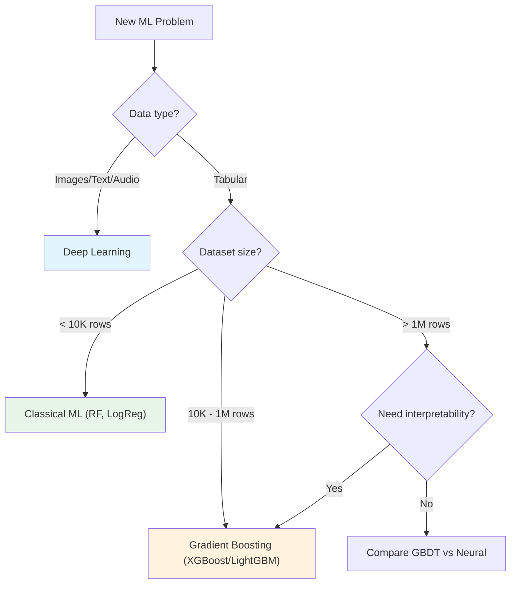
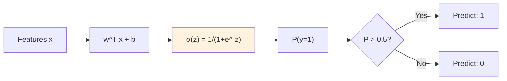
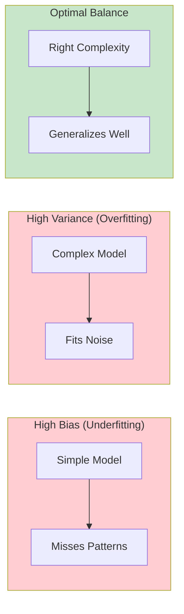
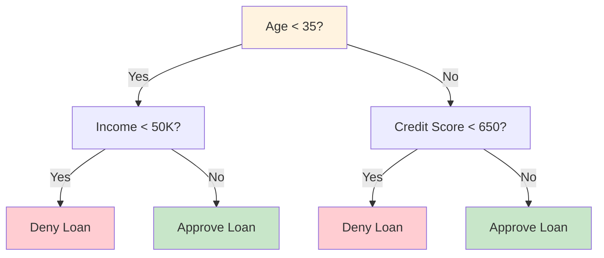
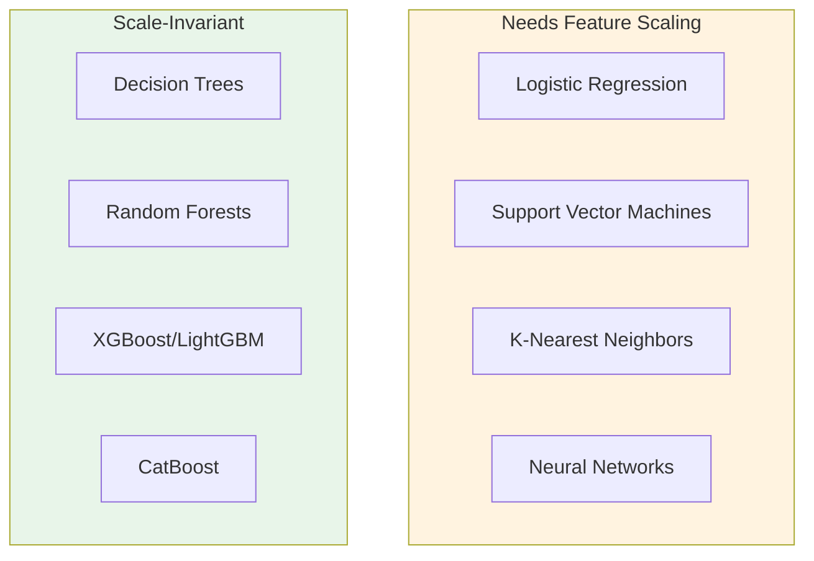

> *"There are two cultures in the use of statistical modeling to reach conclusions from data. One assumes that the data are generated by a given stochastic data model. The other uses algorithmic models and treats the data mechanism as unknown."*
> — **Leo Breiman**, "Statistical Modeling: The Two Cultures" (2001)

In 2016, when deep learning was capturing headlines with AlphaGo and ImageNet victories, a different kind of triumph was unfolding in the world of applied machine learning. Kaggle, the competitive data science platform, ran dozens of competitions that year—and the vast majority were won by gradient boosting, not neural networks.

This is the paradox of modern machine learning: while deep learning dominates research publications and media coverage, **classical algorithms quietly power the bulk of production ML systems**. Credit scores, fraud detection, churn prediction, medical diagnostics, insurance pricing—these systems that affect billions of lives predominantly run on logistic regression, random forests, and gradient boosting machines.

> **Related reading**: For the broader AI arc that popularized deep learning, see [The Long Arc of Machine Intelligence](/posts/overview-of-artificial-intelligence/).

This chapter-based exploration traces the development, mathematics, and practical wisdom behind these foundational algorithms—the workhorses that every ML practitioner must master.

---

## Chapter I: Why Classical ML Still Matters

### The Tabular Data Reality

Here's a truth that surprises many entering the field: **most real-world ML problems involve tabular data**, not images or text. Spreadsheets, database tables, transaction logs—this is where businesses live.

And on tabular data, tree-based ensembles consistently outperform neural networks. A 2022 NeurIPS benchmark study ("Why do tree-based models still outperform deep learning on typical tabular data?") found that gradient-boosted trees and random forests remain state-of-the-art on many medium-sized tabular datasets, even before accounting for their speed and tuning advantages.

Why? Several reasons:

1. **Tabular features are heterogeneous**: Mixing categorical and numerical columns, varying scales, missing values
2. **No inherent structure**: Unlike images (spatial) or text (sequential), there's no obvious architecture
3. **Small to medium datasets**: Deep learning's strength at scale becomes weakness at hundreds or thousands of examples

### When to Choose Classical ML



---

## Chapter II: The Linear Foundation

### Linear Regression: Where It All Begins

Every ML journey starts here. Linear regression is the "hello world" of statistical learning—seemingly simple, yet containing ideas that pervade all of machine learning.

We seek weights $\mathbf{w}$ that minimize squared error between predictions and targets:

$$\hat{y} = \mathbf{w}^T \mathbf{x} + b = \sum_{j=1}^{p} w_j x_j + b$$

$$\mathcal{L} = \frac{1}{n}\sum_{i=1}^{n}(y_i - \hat{y}_i)^2 = MSE$$

The beauty: this has a **closed-form solution**:

$$\mathbf{w}^* = (\mathbf{X}^T\mathbf{X})^{-1}\mathbf{X}^T\mathbf{y}$$

This is the Normal Equation—derived by setting the gradient to zero and solving. No iteration required.

**When does linear regression fail?** When relationships are non-linear. When features are highly collinear. When outliers dominate. These limitations motivate everything that follows.

### Logistic Regression: Classification's Workhorse

For binary classification, we need probabilities in $[0, 1]$. The sigmoid (logistic) function transforms any real number:

$$P(y=1|\mathbf{x}) = \sigma(\mathbf{w}^T\mathbf{x}) = \frac{1}{1 + e^{-\mathbf{w}^T\mathbf{x}}}$$



Training uses **maximum likelihood estimation** (equivalently, minimizing cross-entropy loss):

$$\mathcal{L} = -\frac{1}{n}\sum_{i=1}^{n}[y_i \log(\hat{y}_i) + (1-y_i)\log(1-\hat{y}_i)]$$

Despite its name, logistic regression is a **classifier**, not a regressor. And despite its simplicity, it remains the go-to for:
- **Regulatory-compliant models** (finance, healthcare) where interpretability is required
- **Baseline benchmarks** that more complex models must beat
- **Online learning** scenarios requiring incremental updates

### The Regularization Imperative

With high-dimensional features, linear models overfit. **Regularization** adds a penalty term discouraging large weights:

| Type | Formula | Effect |
|------|---------|--------|
| L2 (Ridge) | $\mathcal{L} + \lambda\|\mathbf{w}\|_2^2$ | Shrinks weights uniformly |
| L1 (Lasso) | $\mathcal{L} + \lambda\|\mathbf{w}\|_1$ | Drives some weights to exactly zero (sparsity) |
| Elastic Net | $\mathcal{L} + \lambda_1\|\mathbf{w}\|_1 + \lambda_2\|\mathbf{w}\|_2^2$ | Best of both |

The hyperparameter $\lambda$ controls regularization strength—a key lever in the **bias-variance tradeoff**.

---

## Chapter III: The Bias-Variance Tradeoff

### The Fundamental Tension

Every prediction error can be decomposed:

$$\text{Expected Error} = \text{Bias}^2 + \text{Variance} + \text{Irreducible Noise}$$

- **Bias**: Error from overly simplistic assumptions (underfitting)
- **Variance**: Error from sensitivity to training data fluctuations (overfitting)



**Example**: A 1-degree polynomial on curved data has high bias. A 20-degree polynomial on 10 points has high variance.

### Managing the Tradeoff

| Strategy | Effect on Bias | Effect on Variance |
|----------|---------------|-------------------|
| More training data | Unchanged | Decreases |
| Reduce model complexity | Increases | Decreases |
| Add regularization | Slightly increases | Decreases |
| Ensemble methods | Slightly increases | Decreases significantly |
| Add features | Decreases | May increase |

This tradeoff is **the fundamental rhythm of applied ML**. Every modeling decision implicitly navigates this tension.

---

## Chapter IV: The Power of Trees

### Decision Trees: Divide and Conquer

A decision tree recursively partitions feature space with splits that maximize **information gain**:

$$\text{Gain}(S, A) = H(S) - \sum_{v \in \text{Values}(A)} \frac{|S_v|}{|S|} H(S_v)$$

where entropy $H(S) = -\sum_c p_c \log p_c$ measures class impurity.



**Strengths**: Interpretable, handles mixed types, captures non-linearity, no scaling needed.

**Weaknesses**: Prone to overfitting, high variance, unstable (small data changes → different tree).

### Leo Breiman's Random Forests

In 2001, Leo Breiman introduced **Random Forests**—a breakthrough that addressed trees' variance problem through **bagging** (bootstrap aggregating) and **random feature selection**.

The algorithm:
1. Create $B$ bootstrap samples (randomly sample with replacement)
2. For each sample, grow a tree, but at each split, consider only $\sqrt{p}$ random features
3. Average predictions (regression) or vote (classification)

**Why does this work?** Breiman's insight: if trees are uncorrelated, averaging reduces variance without increasing bias much. Random feature selection decorrelates trees by forcing each to find different patterns.

The error bound from Breiman's original paper:

$$\text{Generalization Error} \leq \frac{\bar{\rho}(1 - s^2)}{s^2}$$

where $\bar{\rho}$ is average tree correlation and $s$ is strength (1 - error rate). Lower correlation → lower error.

### Vladimir Vapnik's Support Vector Machines

Vladimir Vapnik, working at AT&T Bell Labs in the 1990s (after decades of foundational work in the Soviet Union), formalized the **maximum margin** principle: find the hyperplane that maximizes distance to the nearest training points.

$$\min_{\mathbf{w}, b} \frac{1}{2}\|\mathbf{w}\|^2 \quad \text{s.t.} \quad y_i(\mathbf{w}^T\mathbf{x}_i + b) \geq 1 \quad \forall i$$

The margin is $\frac{2}{\|\mathbf{w}\|}$, so minimizing $\|\mathbf{w}\|^2$ maximizes margin.

**The kernel trick** enables non-linear boundaries without explicitly computing high-dimensional features:

$$K(\mathbf{x}_i, \mathbf{x}_j) = \phi(\mathbf{x}_i)^T\phi(\mathbf{x}_j)$$

Common kernels:
- **Linear**: $K(\mathbf{x}, \mathbf{z}) = \mathbf{x}^T\mathbf{z}$
- **RBF**: $K(\mathbf{x}, \mathbf{z}) = \exp(-\gamma\|\mathbf{x} - \mathbf{z}\|^2)$
- **Polynomial**: $K(\mathbf{x}, \mathbf{z}) = (\mathbf{x}^T\mathbf{z} + c)^d$

SVMs were state-of-the-art for many problems in the 2000s. They remain valuable for high-dimensional, sparse data (text classification) and when margins matter (anomaly detection).

---

## Chapter V: The Boosting Revolution

### Gradient Boosting: Sequential Error Correction

While Random Forests use **bagging** (parallel trees on bootstrapped samples), **boosting** takes a different approach: train trees sequentially, each correcting the errors of previous trees.

The insight (Friedman, 2001): view boosting as **gradient descent in function space**.

For loss function $L(y, F(\mathbf{x}))$, at iteration $m$:

1. Compute pseudo-residuals: $r_i^{(m)} = -\left[\frac{\partial L(y_i, F(\mathbf{x}_i))}{\partial F(\mathbf{x}_i)}\right]_{F=F_{m-1}}$
2. Fit tree $h_m$ to residuals
3. Update model: $F_m(\mathbf{x}) = F_{m-1}(\mathbf{x}) + \eta \cdot h_m(\mathbf{x})$

The learning rate $\eta$ controls update size—smaller values require more iterations but often achieve better final performance.

### XGBoost: The Kaggle Champion

XGBoost (eXtreme Gradient Boosting), released by Tianqi Chen in 2014, became the dominant algorithm for tabular data competitions:

Key innovations:
- **Regularized objective**: Adds penalty on tree structure
- **Sparsity awareness**: Efficiently handles missing values
- **Hardware optimization**: Parallel tree construction, cache-aware access
- **Histogram-based splitting**: Bins continuous features for speed

```python
import xgboost as xgb
from sklearn.datasets import make_classification
from sklearn.model_selection import train_test_split, cross_val_score
import numpy as np

# Create synthetic dataset
X, y = make_classification(
    n_samples=10000, n_features=20, n_informative=15,
    n_redundant=5, random_state=42
)
X_train, X_test, y_train, y_test = train_test_split(
    X, y, test_size=0.2, random_state=42
)

# XGBoost with key hyperparameters
model = xgb.XGBClassifier(
    n_estimators=200,           # Number of boosting rounds
    max_depth=6,                # Tree depth (controls complexity)
    learning_rate=0.1,          # Step size shrinkage
    subsample=0.8,              # Row sampling per tree
    colsample_bytree=0.8,       # Column sampling per tree
    reg_alpha=0.1,              # L1 regularization
    reg_lambda=1.0,             # L2 regularization
    random_state=42,
    eval_metric='logloss'
)

# Fit with early stopping
model.fit(
    X_train, y_train,
    eval_set=[(X_test, y_test)],
    verbose=False
)

# Cross-validation
cv_scores = cross_val_score(model, X_train, y_train, cv=5)
print(f"CV Accuracy: {cv_scores.mean():.4f} (+/- {cv_scores.std()*2:.4f})")

# Feature importance
importances = model.feature_importances_
top_features = np.argsort(importances)[-5:][::-1]
print(f"Top 5 features: {top_features}")
```

### LightGBM: Speed and Memory

LightGBM (Microsoft, 2017) introduced optimizations for even larger datasets:

- **Leaf-wise growth**: Instead of level-by-level, grow the leaf with maximum gain
- **Gradient-based One-Side Sampling (GOSS)**: Focus on instances with large gradients
- **Exclusive Feature Bundling (EFB)**: Combine sparse features

The result: 10-20x faster than XGBoost on large datasets with comparable accuracy.

### CatBoost: Categorical Features Done Right

CatBoost (Yandex, 2017/2018) tackles a chronic pain point in tabular ML: **categorical features**. It uses ordered boosting and target statistics computed without leakage, which often yields strong performance out of the box when categorical columns dominate.

---

## Chapter VI: Production Patterns and Best Practices

### The Feature Scaling Reality



**Rule of thumb**: Algorithms that use distances or gradients need scaling. Trees don't (they only compare feature values).

### The Perfect Comparison Setup

```python
from sklearn.datasets import load_breast_cancer
from sklearn.model_selection import train_test_split, cross_val_score
from sklearn.preprocessing import StandardScaler
from sklearn.pipeline import Pipeline
from sklearn.linear_model import LogisticRegression
from sklearn.ensemble import RandomForestClassifier, GradientBoostingClassifier
from sklearn.svm import SVC
from sklearn.neighbors import KNeighborsClassifier
import xgboost as xgb
import lightgbm as lgb
import numpy as np

# Load data
data = load_breast_cancer()
X_train, X_test, y_train, y_test = train_test_split(
    data.data, data.target, test_size=0.2, random_state=42, stratify=data.target
)

# Define models (with pipelines where scaling needed)
models = {
    'Logistic Regression': Pipeline([
        ('scaler', StandardScaler()),
        ('clf', LogisticRegression(max_iter=1000, C=1.0))
    ]),
    'SVM (RBF)': Pipeline([
        ('scaler', StandardScaler()),
        ('clf', SVC(kernel='rbf', C=1.0, gamma='scale'))
    ]),
    'KNN (k=5)': Pipeline([
        ('scaler', StandardScaler()),
        ('clf', KNeighborsClassifier(n_neighbors=5))
    ]),
    'Random Forest': RandomForestClassifier(n_estimators=100, max_depth=10, random_state=42),
    'Gradient Boosting': GradientBoostingClassifier(n_estimators=100, learning_rate=0.1, random_state=42),
    'XGBoost': xgb.XGBClassifier(n_estimators=100, max_depth=6, learning_rate=0.1, random_state=42),
    'LightGBM': lgb.LGBMClassifier(n_estimators=100, max_depth=6, learning_rate=0.1, random_state=42, verbose=-1)
}

# Compare with cross-validation
print("5-Fold Cross-Validation Results:")
print("-" * 50)
results = {}
for name, model in models.items():
    scores = cross_val_score(model, X_train, y_train, cv=5, scoring='accuracy')
    results[name] = scores
    print(f"{name:25s}: {scores.mean():.4f} (+/- {scores.std()*2:.4f})")

# Find best model
best_model = max(results.items(), key=lambda x: x[1].mean())
print(f"\nBest: {best_model[0]} with {best_model[1].mean():.4f} accuracy")
```

### Common Pitfalls

1. **Forgetting stratification**: Use `stratify=y` for imbalanced classes in train-test split

2. **Leaky preprocessing**: Always fit scaler on training data only, then transform test

3. **Ignoring feature types**: Gradient boosting handles categoricals natively; don't always one-hot encode

4. **Hyperparameter neglect**: Random search or Bayesian optimization can yield 5-10% improvements

5. **Missing value mishandling**: XGBoost/LightGBM handle missing values natively; check before imputing

---

## Chapter VII: The Algorithm Selection Matrix

### When to Use What

| Scenario | First Choice | Why |
|----------|-------------|-----|
| Interpretability required | Logistic Regression | Coefficients have direct meaning |
| Small data (<1K rows) | Random Forest | Robust to overfitting |
| Medium tabular (1K-100K) | XGBoost/LightGBM | Best accuracy/speed tradeoff |
| Large tabular (>100K) | LightGBM/CatBoost | Memory-efficient |
| High-dimensional sparse | SVM (linear) | Handles curse of dimensionality |
| Real-time prediction needed | Logistic Regression | Fastest inference |
| Feature importance critical | Gradient Boosting | SHAP values, gain importance |

### The Production Reality

In my experience at major tech companies, the distribution looks like:

- **50%**: Logistic regression and linear models (speed, interpretability)
- **35%**: Gradient boosting (XGBoost, LightGBM, CatBoost)
- **10%**: Random forests and simple ensembles
- **5%**: Deep learning for tabular (mostly when combined with other modalities)

The percentages vary by domain, but the pattern holds: **simplicity wins in production**.

---

## References and Further Exploration

### Foundational Texts
- Hastie, Tibshirani & Friedman, *The Elements of Statistical Learning* — [Free online](https://hastie.su.domains/ElemStatLearn/)
- James et al., *An Introduction to Statistical Learning* — [Free online](https://www.statlearning.com/)
- Breiman, "Statistical Modeling: The Two Cultures" (2001) — Essential reading on philosophy

### Seminal Papers
- Breiman, "Random Forests" (2001) — [Original paper](https://link.springer.com/article/10.1023/A:1010933404324)
- Cortes & Vapnik, "Support-Vector Networks" (1995)
- Chen & Guestrin, "XGBoost: A Scalable Tree Boosting System" (2016) — [arXiv](https://arxiv.org/abs/1603.02754)
- Ke et al., "LightGBM: A Highly Efficient Gradient Boosting Framework" (2017)
- Prokhorenkova et al., "CatBoost: Unbiased Boosting with Categorical Features" (2018) — [arXiv](https://arxiv.org/abs/1706.09516)
- Grinsztajn, Oyallon & Varoquaux, "Why do tree-based models still outperform deep learning on typical tabular data?" (2022) — [NeurIPS](https://proceedings.neurips.cc/paper_files/paper/2022/hash/0378c7692da36807a0eefb32a78c8fce-Abstract-Conference.html)

### Practical Resources
- scikit-learn documentation and tutorials
- XGBoost, LightGBM, CatBoost documentation
- Kaggle competition kernels (real-world feature engineering)

---

*The most powerful algorithm is the one you understand deeply enough to deploy, debug, and improve. Classical machine learning algorithms have earned their place not through novelty but through decades of battle-tested performance. Master them, and you'll solve most problems you encounter. Ignore them, and you'll spend months training neural networks that a random forest could have beaten in minutes.*
