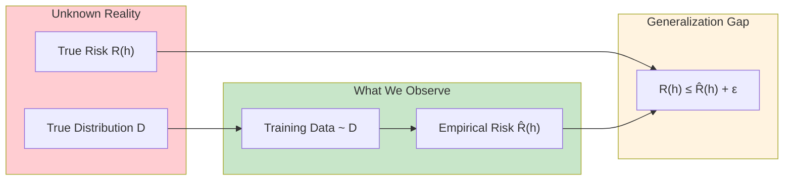
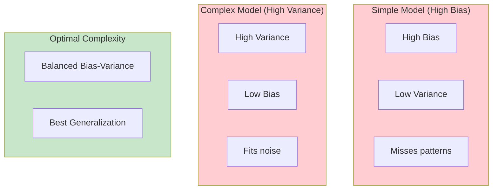
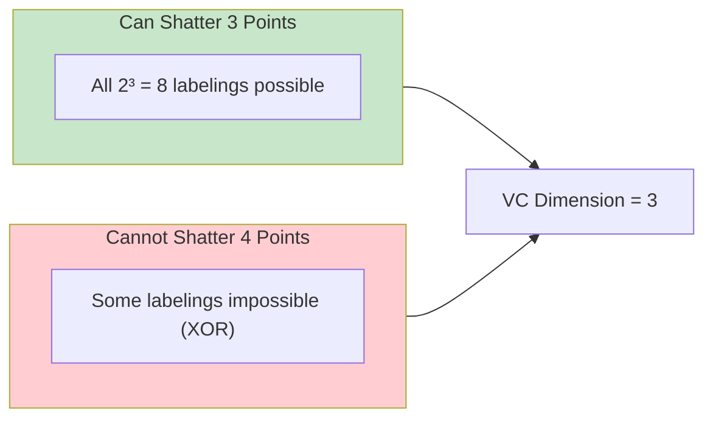
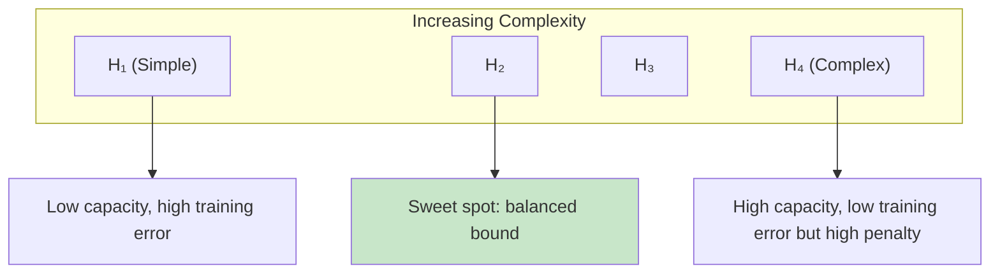
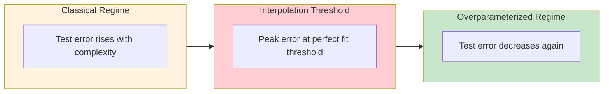

> *"Nothing is more practical than a good theory."*
> — **Vladimir Vapnik**, co-creator of VC theory and Support Vector Machines

In 1984, Leslie Valiant asked a seemingly simple question: when can a computer algorithm be said to have "learned" something? His answer—the Probably Approximately Correct (PAC) learning framework—earned him a Turing Award and established the mathematical foundations for understanding machine learning.

This wasn't just abstract mathematics. Every time you wonder "do I have enough training data?", "should I use a simpler model?", or "why is my neural network memorizing instead of learning?"—you're grappling with questions that statistical learning theory answers rigorously.

This exploration takes you through the mathematical machinery that explains *why* machine learning works, when it fails, and how modern deep learning has challenged and extended these classical foundations.

> **Related reading**: For the practical algorithms that instantiate these ideas, see [Classical ML Algorithms](/posts/classical-machine-learning-algorithms/).

---

## Chapter I: The Central Mystery of Learning

### The Generalization Problem

Consider what machine learning asks us to believe: we show an algorithm 10,000 examples of cats and dogs, and somehow it learns to classify *any* cat or dog it will ever encounter—including breeds never seen in training.

This is extraordinary. Why should patterns in training data say anything about unseen examples?

The answer isn't mystical—it's mathematical. Statistical learning theory provides **guarantees**: under specific conditions, training performance *must* approximate test performance.

### Empirical Risk Minimization

All supervised learning can be framed as **Empirical Risk Minimization (ERM)**:

We want to minimize **true risk** (expected loss on the data distribution):
$$R(h) = \mathbb{E}_{(x,y) \sim D}[\ell(h(x), y)]$$

But we can't compute this—we don't know the true distribution $D$. Instead, we minimize **empirical risk** (average loss on training data):
$$\hat{R}(h) = \frac{1}{n}\sum_{i=1}^n \ell(h(x_i), y_i)$$

The question: when does low empirical risk imply low true risk?



---

## Chapter II: The Bias-Variance Tradeoff

### Decomposing Error

For regression with squared loss, expected test error can be decomposed exactly:

$$\mathbb{E}[(y - \hat{f}(x))^2] = \underbrace{\text{Bias}[\hat{f}(x)]^2}_{\text{Underfitting}} + \underbrace{\text{Var}[\hat{f}(x)]}_{\text{Overfitting}} + \underbrace{\sigma^2}_{\text{Noise}}$$

**Bias** measures how far the average prediction is from the truth:
$$\text{Bias}[\hat{f}(x)] = \mathbb{E}[\hat{f}(x)] - f(x)$$

**Variance** measures how much predictions vary across different training sets:
$$\text{Var}[\hat{f}(x)] = \mathbb{E}[(\hat{f}(x) - \mathbb{E}[\hat{f}(x)])^2]$$

**Irreducible noise** ($\sigma^2$) is inherent randomness in the target—no model can eliminate it.

### The Tradeoff Visualized



### Practical Implications

| Observation | Diagnosis | Solution |
|-------------|-----------|----------|
| High training AND test error | High bias (underfitting) | More features, more complex model |
| Low training, high test error | High variance (overfitting) | More data, regularization, simpler model |
| Training and test error converge | Appropriate complexity | Add data to improve both |

---

## Chapter III: PAC Learning and Sample Complexity

### Leslie Valiant's Framework

In 1984, Leslie Valiant introduced **Probably Approximately Correct (PAC)** learning. The question: given a hypothesis class $\mathcal{H}$, how many training examples do we need to learn a good hypothesis?

**PAC-learnable**: A concept class is PAC-learnable if there exists an algorithm that, for any target concept and distribution:
- With probability at least $1 - \delta$ (high confidence)
- Returns a hypothesis with error at most $\epsilon$ (approximately correct)
- Using polynomially many examples in $1/\epsilon$, $1/\delta$, and problem size

### The Sample Complexity Formula

For a finite hypothesis class $|\mathcal{H}|$:

$$m \geq \frac{1}{\epsilon}\left(\ln|\mathcal{H}| + \ln\frac{1}{\delta}\right)$$

For hypothesis classes characterized by VC dimension $d$:

$$m \geq \frac{c}{\epsilon^2}\left(d \ln\frac{1}{\epsilon} + \ln\frac{1}{\delta}\right)$$

**Interpretation**:
- Need more examples for higher accuracy (smaller $\epsilon$)
- Need more examples for higher confidence (smaller $\delta$)
- Need more examples for more complex hypothesis classes (larger $d$)

### The Fundamental Theorem

A concept class is PAC-learnable **if and only if** its VC dimension is finite.

This is profound: it means we can determine learnability purely from hypothesis class properties, independent of the algorithm.

---

## Chapter IV: VC Dimension — Measuring Model Capacity

### Vapnik and Chervonenkis's Breakthrough

In the 1960s and 1970s, Vladimir Vapnik and Alexey Chervonenkis developed a rigorous measure of hypothesis class complexity: the **VC dimension**.

**Definition**: The VC dimension of a hypothesis class $\mathcal{H}$ is the maximum number of points that can be **shattered** by $\mathcal{H}$—meaning $\mathcal{H}$ can realize all $2^n$ possible labelings.

**Example: Linear classifiers in 2D**



For 4 points, no matter how arranged, there's at least one labeling (like XOR) that no line can separate. So linear classifiers in 2D have VC dimension 3.

### VC Dimensions of Common Classes

| Hypothesis Class | VC Dimension |
|-----------------|--------------|
| Linear classifiers in $\mathbb{R}^d$ | $d + 1$ |
| Axis-aligned rectangles in $\mathbb{R}^2$ | 4 |
| Circles in $\mathbb{R}^2$ | 3 |
| Decision stumps | 2 |
| 1-hidden-layer neural net (d inputs, k hidden) | $O(dk)$ |
| k-NN (k=1) | $\infty$ |

**Key insight**: VC dimension captures *representation power*, not number of parameters. Infinite VC dimension means any labeling can be realized—essentially memorization.

### The Generalization Bound

Vapnik-Chervonenkis theory gives us:

$$R(h) \leq \hat{R}(h) + \sqrt{\frac{d(\ln(2n/d) + 1) - \ln(\delta/4)}{n}}$$

with probability at least $1 - \delta$.

**Reading this**: True error is bounded by training error plus a complexity term that:
- Grows with VC dimension $d$ (more complex → larger bound)
- Shrinks with sample size $n$ (more data → tighter bound)

This justifies regularization: by constraining the hypothesis class, we reduce $d$ and tighten the bound.

---

## Chapter V: Structural Risk Minimization

### Vapnik's Principle

Given VC theory, Vladimir Vapnik proposed **Structural Risk Minimization** (SRM): don't just minimize training error—balance it against model complexity.

Create nested hypothesis classes: $\mathcal{H}_1 \subset \mathcal{H}_2 \subset ... \subset \mathcal{H}_K$

For each, compute:
$$\text{Risk Bound}_k = \hat{R}_k + \text{Complexity Penalty}_k$$

Choose the class minimizing this bound.



### Regularization as SRM

L2-regularized loss:
$$\min_{\mathbf{w}} \frac{1}{n}\sum_{i=1}^n \ell(f_\mathbf{w}(x_i), y_i) + \lambda\|\mathbf{w}\|^2$$

The constraint $\|\mathbf{w}\| \leq B$ defines a hypothesis class with bounded complexity. Larger $\lambda$ → smaller effective class → lower VC dimension → tighter bound (but higher bias).

---

## Chapter VI: Beyond Classical Theory — Modern Deep Learning

### The Paradox of Overparameterization

Classical theory predicts disaster for huge models: with billions of parameters and thousands of examples, VC bounds blow up. Yet deep neural networks generalize beautifully.

This is the **generalization puzzle** of deep learning:

| Classical Expectation | Observed Reality |
|----------------------|------------------|
| More parameters → more overfitting | Large models generalize well |
| Perfect training fit → memorization | Perfect fit, good test performance |
| Need n >> d for generalization | Works with n << d |

### Double Descent

In 2019, Belkin et al. and Nakkiran et al. documented a striking phenomenon: the classical U-shaped test error curve has a **second descent**.



**Key observations**:
- Peak occurs at "interpolation threshold" where model can just fit training data
- Beyond this, adding more parameters *improves* generalization
- Effect appears in model size, training time, and dataset size dimensions

### Benign Overfitting

**Benign overfitting** describes models that perfectly fit noisy training data (including label noise) yet generalize well. This contradicts classical predictions.

Conditions enabling benign overfitting:
1. **High effective dimensionality**: Feature space much larger than samples
2. **Implicit regularization**: Optimization finds "simple" solutions
3. **Data structure**: Signal concentrates in a subspace, noise spreads everywhere

Recent theory formalizes this phenomenon in linear regression and shows how minimum-norm solutions can generalize despite interpolation.

### Implicit Regularization

Even without explicit regularization, optimization dynamics in neural networks favor "simpler" solutions:

- **Gradient descent on linear models** converges to minimum-norm solution
- **Early stopping** limits effective model capacity
- **Stochastic gradients** add regularizing noise

This suggests: the effective hypothesis class is much smaller than the parameterized function class.

---

## Chapter VII: Practical Tools for the Theoretically-Minded

### Cross-Validation: Theory in Practice

Cross-validation provides an unbiased estimate of generalization error:

```python
import numpy as np
from sklearn.model_selection import cross_val_score, learning_curve, validation_curve
from sklearn.linear_model import Ridge
from sklearn.preprocessing import PolynomialFeatures
from sklearn.pipeline import make_pipeline
import matplotlib.pyplot as plt

# Generate synthetic data with known true function
np.random.seed(42)
n = 200
X = np.sort(np.random.uniform(0, 1, n)).reshape(-1, 1)
y_true = np.sin(2 * np.pi * X).ravel()
y = y_true + np.random.normal(0, 0.3, n)

# Learning curve: diagnose underfitting vs overfitting
def plot_learning_curve(model, X, y, title):
    """
    Learning curve reveals bias-variance tradeoff:
    - Converging curves with high error = high bias (underfitting)
    - Wide gap between curves = high variance (overfitting)
    """
    train_sizes, train_scores, val_scores = learning_curve(
        model, X, y, train_sizes=np.linspace(0.1, 1.0, 10), cv=5,
        scoring='neg_mean_squared_error'
    )

    train_mean = -train_scores.mean(axis=1)
    val_mean = -val_scores.mean(axis=1)

    plt.figure(figsize=(8, 5))
    plt.plot(train_sizes, train_mean, 'o-', label='Training error', color='blue')
    plt.plot(train_sizes, val_mean, 'o-', label='Validation error', color='red')
    plt.xlabel('Training set size')
    plt.ylabel('Mean Squared Error')
    plt.title(title)
    plt.legend()
    plt.grid(True, alpha=0.3)

    return train_mean[-1], val_mean[-1]

# Compare different complexities
fig, axes = plt.subplots(1, 3, figsize=(15, 4))

complexities = [
    ("Underfitting (Degree 1)", 1),
    ("Good fit (Degree 4)", 4),
    ("Overfitting (Degree 15)", 15)
]

for ax, (title, degree) in zip(axes, complexities):
    model = make_pipeline(PolynomialFeatures(degree), Ridge(alpha=0.001))
    train_sizes, train_scores, val_scores = learning_curve(
        model, X, y, train_sizes=np.linspace(0.1, 1.0, 10), cv=5,
        scoring='neg_mean_squared_error'
    )

    ax.plot(train_sizes, -train_scores.mean(axis=1), 'o-', label='Training', color='blue')
    ax.plot(train_sizes, -val_scores.mean(axis=1), 'o-', label='Validation', color='red')
    ax.set_xlabel('Training size')
    ax.set_ylabel('MSE')
    ax.set_title(title)
    ax.legend()
    ax.grid(True, alpha=0.3)

plt.tight_layout()
plt.savefig('learning_curves_comparison.png', dpi=150)

# Validation curve: choose regularization strength
model = make_pipeline(PolynomialFeatures(10), Ridge())
alphas = np.logspace(-4, 4, 20)

train_scores, val_scores = validation_curve(
    model, X, y, param_name='ridge__alpha', param_range=alphas,
    cv=5, scoring='neg_mean_squared_error'
)

plt.figure(figsize=(8, 5))
plt.semilogx(alphas, -train_scores.mean(axis=1), 'o-', label='Training error')
plt.semilogx(alphas, -val_scores.mean(axis=1), 'o-', label='Validation error')
plt.xlabel('Regularization strength (α)')
plt.ylabel('MSE')
plt.title('Validation Curve: Finding Optimal Regularization')
plt.legend()
plt.grid(True, alpha=0.3)

# Find optimal alpha
optimal_idx = np.argmin(-val_scores.mean(axis=1))
optimal_alpha = alphas[optimal_idx]
plt.axvline(optimal_alpha, color='green', linestyle='--', label=f'Optimal α={optimal_alpha:.4f}')
plt.legend()
plt.savefig('validation_curve.png', dpi=150)

print(f"Optimal regularization: α = {optimal_alpha:.4f}")
```

### Diagnostic Checklist

| Symptom | Diagnosis | Theory Says |
|---------|-----------|-------------|
| Learning curve: both errors high, converged | High bias | Increase model capacity |
| Learning curve: train low, val high, gap persists | High variance | Need more data or regularization |
| Validation curve: optimal λ at extreme | Wrong complexity range | Expand search range |
| Train error = 0, test error reasonable | Possibly benign overfitting | OK for overparameterized models |

---

## Chapter VIII: The Practitioner's Theory Toolkit

### What Theory Actually Tells You

1. **Sample complexity scales with model complexity**: The VC generalization bound gives rough guidance. For useful learning, you typically need $n \gg d$.

2. **Regularization works because it controls complexity**: L1/L2 penalties shrink the effective hypothesis class.

3. **Cross-validation is theoretically justified**: It provides an unbiased estimate of generalization error.

4. **More parameters don't always hurt**: In the overparameterized regime, implicit regularization can keep generalization tight.

5. **Distribution shift breaks everything**: All bounds assume train and test from the same distribution.

### Rules of Thumb

| Principle | Guidance |
|-----------|----------|
| Bias-Variance | Start simple, add complexity only if underfitting |
| Sample Complexity | Need ~10-100× samples per effective parameter |
| Regularization | Always use some regularization with complex models |
| Validation | Never tune on test set; use CV or held-out validation |
| Distribution | Validate on production-realistic data splits |

---

## References and Further Exploration

### Foundational Texts
- Shalev-Shwartz & Ben-David, *Understanding Machine Learning: From Theory to Algorithms* — [Free online](https://www.cs.huji.ac.il/~shais/UnderstandingMachineLearning/)
- Abu-Mostafa, Magdon-Ismail & Lin, *Learning From Data* — [Free lectures online](https://work.caltech.edu/telecourse.html)
- Vapnik, *The Nature of Statistical Learning Theory* — The original VC theory book

### Seminal Papers
- Valiant, "A Theory of the Learnable" (1984) — [PAC learning origin](https://dl.acm.org/doi/10.1145/1968.1972)
- Vapnik & Chervonenkis, "On the Uniform Convergence of Relative Frequencies of Events to Their Probabilities" (1971)
- Belkin et al., "Reconciling Modern Machine Learning Practice and the Bias-Variance Trade-off" (2019) — [Double descent](https://arxiv.org/abs/1812.11118)
- Nakkiran et al., "Deep Double Descent" (2019) — [OpenAI paper](https://arxiv.org/abs/1912.02292)

### Modern Perspectives
- Zhang et al., "Understanding Deep Learning Requires Rethinking Generalization" (2017)
- Bartlett et al., "Benign Overfitting in Linear Regression" (2020) — [arXiv](https://arxiv.org/abs/1906.11300)

---

*The gap between theory and practice in machine learning is real—but so is the gap between flying by instrument and flying blind. Understanding why learning works, even approximately, makes you a more effective practitioner. When your model fails to generalize, theory gives you a vocabulary for diagnosis and a menu of solutions. When your overparameterized neural network works despite all predictions, theory invites you to understand why. The mathematics of generalization is still being written—and the pen is in the hands of those who both build and think.*
