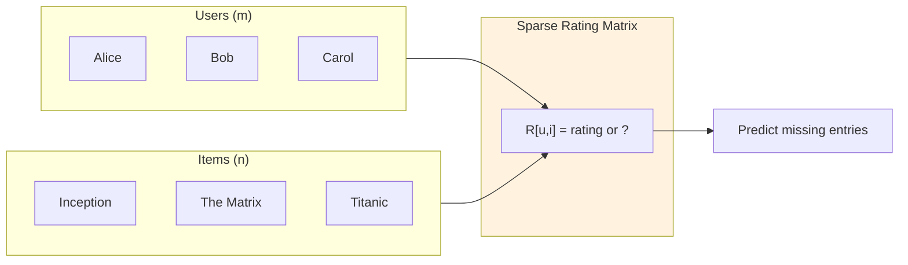
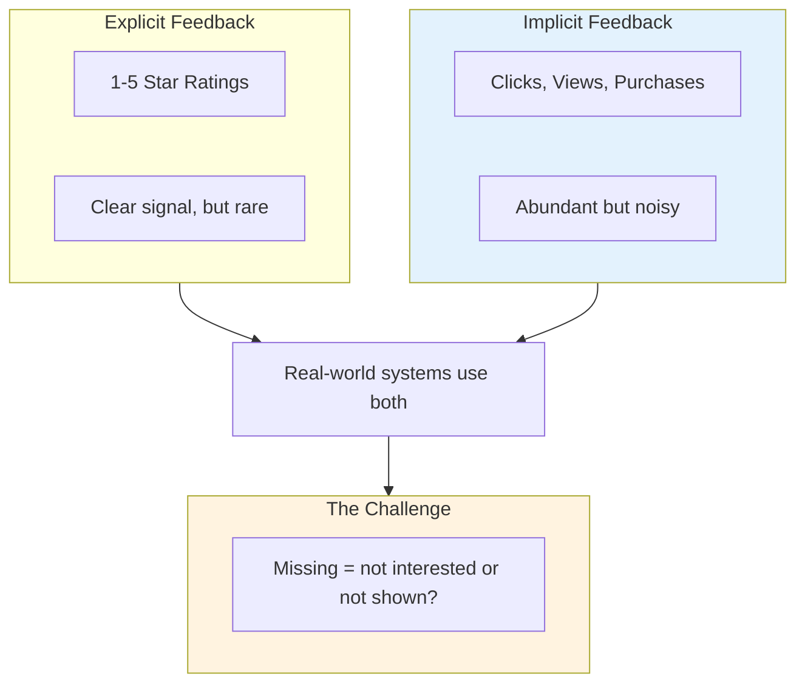
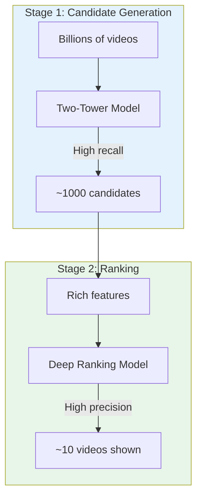
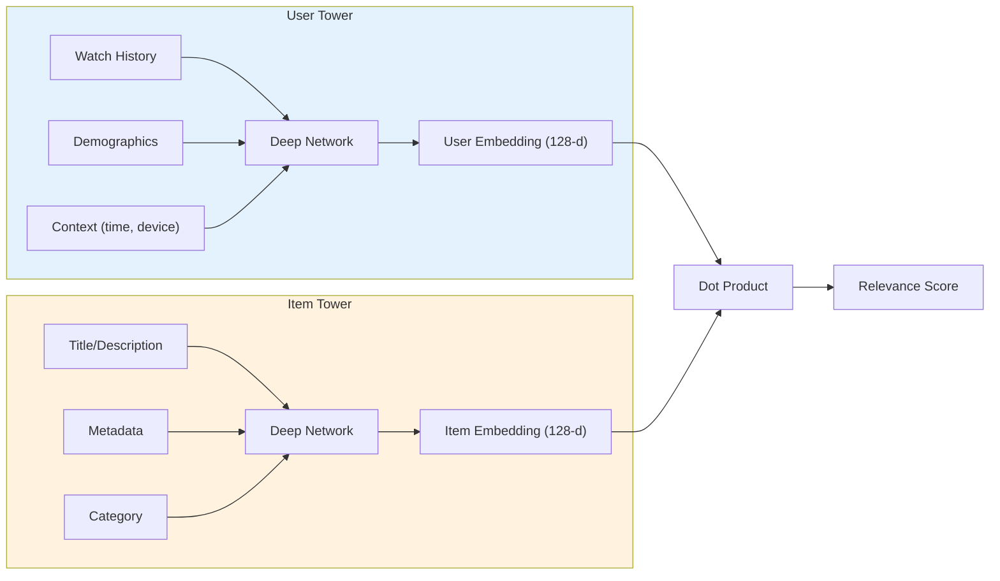

> *"We're not competing with sleep. We're competing with HBO, Amazon, Hulu, and everything else out there."*
> — **Reed Hastings**, Netflix CEO

On October 2, 2006, Netflix announced a challenge that would captivate the machine learning world: improve their movie recommendation algorithm by 10%, and win $1 million. Three years and thousands of competitors later, the winning team—BellKor's Pragmatic Chaos—crossed the finish line with an ensemble of over 100 models.

The Netflix Prize didn't just advance recommender systems. It launched careers, sparked research programs, and demonstrated that recommendation wasn't just a business problem—it was one of the grand challenges of applied machine learning.

This exploration traces the journey from that pivotal competition through modern neural retrieval systems, revealing how platforms serving billions of personalized recommendations actually work.

> **Related reading**: Recommender systems share deep connections with [Information Retrieval](/posts/information-retrieval-key-concepts/)—both solve the retrieval problem. And at scale, recommendation becomes a [Learning to Rank](/posts/learning-to-rank/) challenge.

---

## Chapter I: The $1 Million Question

### The Netflix Prize

Netflix's 2006 challenge was deceptively simple: predict how users would rate movies. The dataset was unprecedented—100 million ratings from 480,000 users across 17,770 movies. The metric was RMSE (Root Mean Squared Error). The goal: beat Netflix's existing Cinematch system by 10%.

The competition revealed several truths:

1. **The power of ensembles**: No single algorithm won. BellKor's winning solution blended matrix factorization, Restricted Boltzmann Machines, k-nearest neighbors, and dozens of variations.

2. **Diminishing returns**: The first 8% improvement came quickly. The final 2% took years and extraordinary complexity—so complex Netflix never fully deployed it.

3. **The importance of temporal dynamics**: What you watched last week matters more than what you watched last year.

### Why Recommendations Matter

Netflix estimates recommendations save $1 billion annually by reducing churn. Amazon attributes 35% of purchases to recommendations. YouTube's recommendation engine drives over 70% of watch time.

For the ML practitioner, recommendation is a unique arena:
- **Extreme sparsity**: Users interact with tiny fractions of available items
- **Implicit signals**: Clicks, views, and dwell time—not explicit ratings
- **Real-time serving**: Recommendations computed in milliseconds at massive scale
- **Multi-objective optimization**: Balance engagement, diversity, freshness, revenue

---

## Chapter II: Collaborative Filtering Foundations

### The User-Item Matrix

At its core, recommendation is matrix completion. We observe a sparse matrix $\mathbf{R} \in \mathbb{R}^{m \times n}$ where $R_{ui}$ is user $u$'s interaction with item $i$. Most entries are missing.



### Two Philosophies

**Content-based filtering**: "You liked action movies, here are more action movies."
- Uses item features (genre, actors, description)
- Doesn't require other users' data
- Limited by feature quality; can't discover unexpected preferences

**Collaborative filtering**: "Users like you also liked this."
- Uses only interaction patterns—no item features needed
- Discovers non-obvious relationships (people who like art house films often like jazz albums)
- Suffers from cold start for new users/items

### The Sparsity Challenge

Consider Netflix's scale: ~200 million users, ~15,000 titles. That's 3 trillion possible user-item pairs. Even an active user might watch 100 titles—0.0000007% of possibilities.

Learning from this extreme sparsity is recommender systems' defining challenge.

---

## Chapter III: Matrix Factorization — The Netflix Prize Era

### The Core Idea

Factor the rating matrix into latent representations:

$$\mathbf{R} \approx \mathbf{P}\mathbf{Q}^T$$

where:
- $\mathbf{P} \in \mathbb{R}^{m \times k}$: User latent factors (each row is a user's "taste vector")
- $\mathbf{Q} \in \mathbb{R}^{n \times k}$: Item latent factors (each row is an item's "characteristic vector")
- $k$: Latent dimension (typically 50-200)

Predicted rating:
$$\hat{R}_{ui} = \mathbf{p}_u^T \mathbf{q}_i = \sum_{f=1}^{k} p_{uf} \cdot q_{if}$$

The latent factors learn interpretable patterns: one dimension might capture "cerebral vs. popcorn," another "romance vs. action."

### Adding Biases

Users and items have inherent biases. Alice rates everything 4.5 stars; Bob is a harsh 2.5 critic. *The Godfather* averages 4.3; a B-movie averages 2.1.

The SVD++ model captures this:

$$\hat{R}_{ui} = \mu + b_u + b_i + \mathbf{p}_u^T\mathbf{q}_i$$

where:
- $\mu$: Global average rating
- $b_u$: User bias (tendency to rate high/low)
- $b_i$: Item bias (overall popularity)

### Training: ALS and SGD

**Alternating Least Squares (ALS)**:
1. Fix $\mathbf{Q}$, solve for each $\mathbf{p}_u$ (closed-form)
2. Fix $\mathbf{P}$, solve for each $\mathbf{q}_i$ (closed-form)
3. Repeat until convergence

ALS parallelizes elegantly—each user/item update is independent.

**Stochastic Gradient Descent (SGD)**:
For each observed $(u, i, R_{ui})$:
$$e_{ui} = R_{ui} - \hat{R}_{ui}$$
$$\mathbf{p}_u \leftarrow \mathbf{p}_u + \alpha(e_{ui}\mathbf{q}_i - \lambda\mathbf{p}_u)$$
$$\mathbf{q}_i \leftarrow \mathbf{q}_i + \alpha(e_{ui}\mathbf{p}_u - \lambda\mathbf{q}_i)$$

SGD works better for explicit ratings; ALS shines with implicit feedback.

---

## Chapter IV: The Implicit Feedback Revolution

### Clicks Aren't Ratings

In the real world, explicit ratings are rare. Most signals are **implicit**: clicks, views, purchases, dwell time, scrolls. The challenge: a non-interaction might mean "not interested" or "never seen."

The implicit feedback formulation (Hu, Koren & Volinsky, 2008):

$$\min_{\mathbf{P}, \mathbf{Q}} \sum_{u,i} c_{ui}(p_{ui} - \mathbf{p}_u^T\mathbf{q}_i)^2 + \lambda(\|\mathbf{P}\|^2 + \|\mathbf{Q}\|^2)$$

where:
- $p_{ui} \in \{0, 1\}$: preference (did user interact?)
- $c_{ui} = 1 + \alpha \cdot r_{ui}$: confidence (more interactions → higher confidence)

The insight: treat missing values as weak negatives (low confidence), not unknown.



### BPR: Bayesian Personalized Ranking

Rather than predicting absolute ratings, optimize relative rankings. For each user, prefer items they interacted with over items they didn't:

$$\sum_{(u,i,j) \in D_s} \log \sigma(\hat{R}_{ui} - \hat{R}_{uj}) - \lambda \|\Theta\|^2$$

where $(u, i, j)$ means user $u$ prefers item $i$ over item $j$.

BPR connects recommendation to [Learning to Rank](/posts/learning-to-rank/)—a pairwise ranking loss.

---

## Chapter V: Two-Tower Neural Retrieval

### The YouTube Architecture

In 2016, Google published "Deep Neural Networks for YouTube Recommendations," revealing the architecture behind YouTube's system. The key insight: divide the problem into two stages.



**Candidate Generation** (Two-Tower):
- User tower: encodes user history, context, demographics → user embedding
- Item tower: encodes item features → item embedding
- Similarity: dot product or cosine between embeddings
- Goal: high recall—retrieve all potentially relevant items

**Ranking**:
- Takes ~1000 candidates from retrieval
- Uses rich features: watch time history, recency, item quality signals
- Goal: high precision—rank the truly relevant items highest

### The Two-Tower Model



**Why two towers?**
- Item embeddings can be pre-computed and indexed (using approximate nearest neighbor search like FAISS)
- User embedding computed at request time
- Similarity search over billions of items in milliseconds

This architecture connects directly to [Dense Passage Retrieval for search](/posts/information-retrieval-key-concepts/)—same dual-encoder principle.

---

## Chapter VI: Production Implementation

### Matrix Factorization with Implicit Feedback

```python
import numpy as np
from scipy.sparse import csr_matrix
import implicit
from sklearn.model_selection import train_test_split

class RecommenderSystem:
    """
    Production-style recommender using implicit feedback.

    This implements the weighted alternating least squares (WALS)
    approach from Hu, Koren & Volinsky (2008).
    """

    def __init__(self, factors=64, regularization=0.01, iterations=20):
        self.factors = factors
        self.regularization = regularization
        self.iterations = iterations
        self.model = None
        self.user_item_matrix = None

    def fit(self, user_ids, item_ids, values):
        """
        Train on implicit feedback data.

        Args:
            user_ids: Array of user indices
            item_ids: Array of item indices
            values: Array of interaction strengths (e.g., view counts)
        """
        n_users = max(user_ids) + 1
        n_items = max(item_ids) + 1

        # Create sparse user-item matrix
        self.user_item_matrix = csr_matrix(
            (values, (user_ids, item_ids)),
            shape=(n_users, n_items)
        )

        # Train ALS model
        self.model = implicit.als.AlternatingLeastSquares(
            factors=self.factors,
            regularization=self.regularization,
            iterations=self.iterations,
            random_state=42
        )
        self.model.fit(self.user_item_matrix)

        return self

    def recommend(self, user_id, n=10, filter_seen=True):
        """Get top-N recommendations for a user."""
        if self.model is None:
            raise ValueError("Model not trained. Call fit() first.")

        recommendations = self.model.recommend(
            user_id,
            self.user_item_matrix[user_id],
            N=n,
            filter_already_liked_items=filter_seen
        )
        return recommendations

    def similar_items(self, item_id, n=10):
        """Find similar items based on learned embeddings."""
        return self.model.similar_items(item_id, N=n)

    def explain(self, user_id, item_id, n_contributions=5):
        """
        Explain why an item was recommended.

        Returns items the user interacted with that contributed
        to this recommendation.
        """
        # Get user and item factors
        user_factors = self.model.user_factors[user_id]
        item_factors = self.model.item_factors[item_id]

        # Find user's interacted items
        user_items = self.user_item_matrix[user_id].nonzero()[1]

        contributions = []
        for seen_item in user_items:
            seen_factors = self.model.item_factors[seen_item]
            # Contribution = similarity between seen item and recommended item
            similarity = np.dot(item_factors, seen_factors) / (
                np.linalg.norm(item_factors) * np.linalg.norm(seen_factors) + 1e-8
            )
            contributions.append((seen_item, similarity))

        # Return top contributors
        contributions.sort(key=lambda x: x[1], reverse=True)
        return contributions[:n_contributions]


# Example usage
np.random.seed(42)

# Simulate e-commerce interactions
n_users, n_items = 5000, 1000
n_interactions = 50000

user_ids = np.random.randint(0, n_users, n_interactions)
item_ids = np.random.randint(0, n_items, n_interactions)
values = np.random.randint(1, 10, n_interactions)  # e.g., page views

# Train model
recommender = RecommenderSystem(factors=64, iterations=15)
recommender.fit(user_ids, item_ids, values)

# Get recommendations
user = 42
recs = recommender.recommend(user, n=5)
print(f"Recommendations for user {user}:")
for item_id, score in recs:
    print(f"  Item {item_id}: score {score:.4f}")

# Explain a recommendation
if recs:
    top_item = recs[0][0]
    explanation = recommender.explain(user, top_item)
    print(f"\nThis was recommended because you liked items: {[x[0] for x in explanation]}")
```

### Evaluation: Beyond RMSE

Netflix Prize used RMSE, but it often doesn't correlate with real engagement. Better metrics:

| Metric | What It Measures | When to Use |
|--------|------------------|-------------|
| Precision@K | Fraction of top-K that are relevant | When false positives are costly |
| Recall@K | Fraction of relevant items in top-K | When coverage matters |
| NDCG | Position-weighted ranking quality | When position matters (it usually does) |
| Hit Rate@K | Did we recommend something they consumed? | Simple sanity check |
| Coverage | Fraction of items ever recommended | Detecting popularity bias |

**The offline-online gap**: Offline metrics often don't predict online A/B test wins. Always validate with experiments.

---

## Chapter VII: Challenges and Advanced Topics

### The Cold Start Problem

New users have no history. New items have no interactions. Solutions:

1. **Content-based fallback**: Use item features for new items
2. **Popularity**: Show what's trending
3. **Exploration**: Multi-armed bandits to learn quickly (see [Contextual Bandits](/posts/contextual-bandits/))
4. **Side information**: Onboarding surveys, demographics

### Popularity Bias

Models naturally favor popular items (more training signal). But long-tail discovery matters for engagement and diversity.

Mitigation strategies:
- **Popularity sampling**: Undersample popular items during training
- **Inverse propensity weighting**: Weight rare items more heavily
- **Diversity constraints**: Ensure categorical diversity in recommendations
- **Calibration**: Match recommendation distribution to user consumption patterns

### Position Bias

Users click items near the top regardless of quality. A clicked item isn't necessarily better—it was just shown in a better position.

Solutions:
- **Inverse propensity weighting from position**: Weight clicks by 1/P(shown | position)
- **Unbiased LTR**: Learning-to-rank methods that account for position bias

### Multi-Objective Optimization

Real systems optimize multiple goals: engagement, diversity, freshness, revenue. See [Multi-Objective Optimization](/posts/multi-objective-optimization/) for approaches including Pareto optimization and scalarization.

---

## Chapter VIII: The Modern Stack

### From Netflix Prize to Production

| Era | Approach | Characteristics |
|-----|----------|-----------------|
| 2006-2012 | Matrix Factorization | Netflix Prize era; offline, batch |
| 2013-2016 | Feature-based ML | Gradient boosting, feature engineering |
| 2016-2020 | Deep Learning | Two-tower, deep ranking, end-to-end |
| 2020+ | Foundation Models | LLM-enhanced recommendations, conversational |

### Where Recommendations Meet Other ML

Recommender systems connect to almost every ML discipline:

- **[Information Retrieval](/posts/information-retrieval-key-concepts/)**: Same retrieval/ranking paradigm
- **[Learning to Rank](/posts/learning-to-rank/)**: Recommendation as ranking
- **[Contextual Bandits](/posts/contextual-bandits/)**: Explore-exploit for cold start
- **[Causal Inference](/posts/joining-amazon-causal-inference/)**: Debiasing recommendations
- **[A/B Testing](/posts/ab-testing-statistics/)**: Validating recommendation changes

---

## References and Further Exploration

### Foundational Papers
- Koren, Bell & Volinsky, "Matrix Factorization Techniques for Recommender Systems" (IEEE Computer, 2009)
- Hu, Koren & Volinsky, "Collaborative Filtering for Implicit Feedback Datasets" (ICDM 2008)
- Rendle et al., "BPR: Bayesian Personalized Ranking from Implicit Feedback" (UAI 2009)
- Covington et al., "Deep Neural Networks for YouTube Recommendations" (RecSys 2016)

### Modern Approaches
- He et al., "Neural Collaborative Filtering" (WWW 2017)
- Kang & McAuley, "Self-Attentive Sequential Recommendation" (ICDM 2018) — SASRec
- Sun et al., "BERT4Rec: Sequential Recommendation with Transformers" (CIKM 2019)

### Practical Resources
- [Implicit](https://github.com/benfred/implicit) — Fast ALS for implicit feedback
- [RecBole](https://recbole.io/) — Comprehensive recommendation library
- Google's [Recommenders TFX](https://www.tensorflow.org/recommenders) tutorials

---

*Netflix never fully deployed the $1 million algorithm—it was too complex for production. But the Netflix Prize did something more valuable: it created a generation of researchers obsessed with personalization. Today's systems serving billions of recommendations trace their lineage to that competition. The problem has evolved from rating prediction to real-time multi-objective ranking, but the goal remains: find what each person wants, from everything that exists.*
