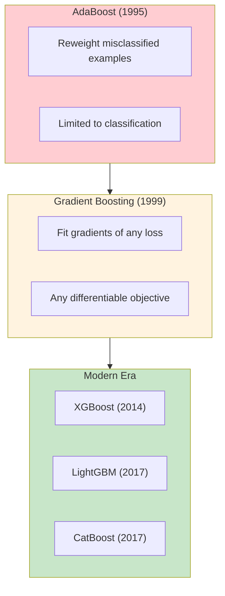
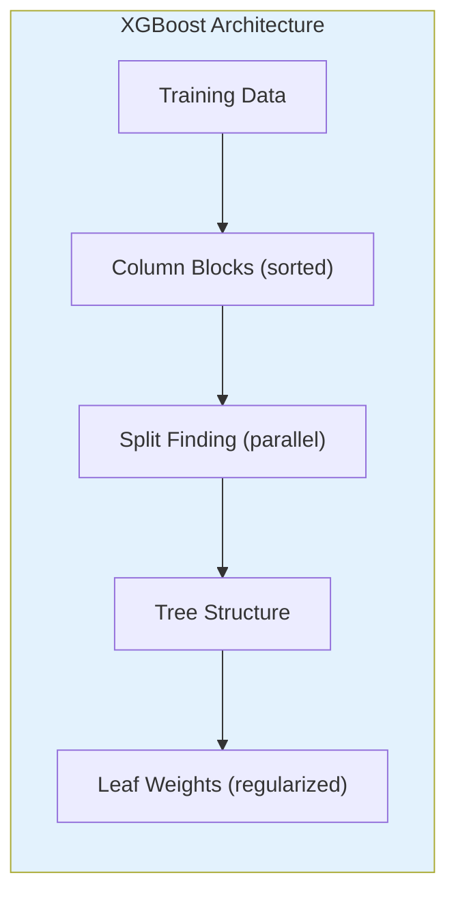
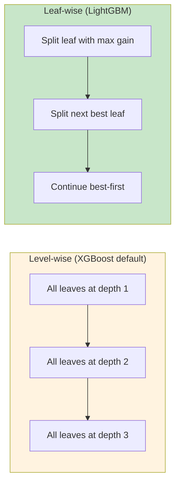
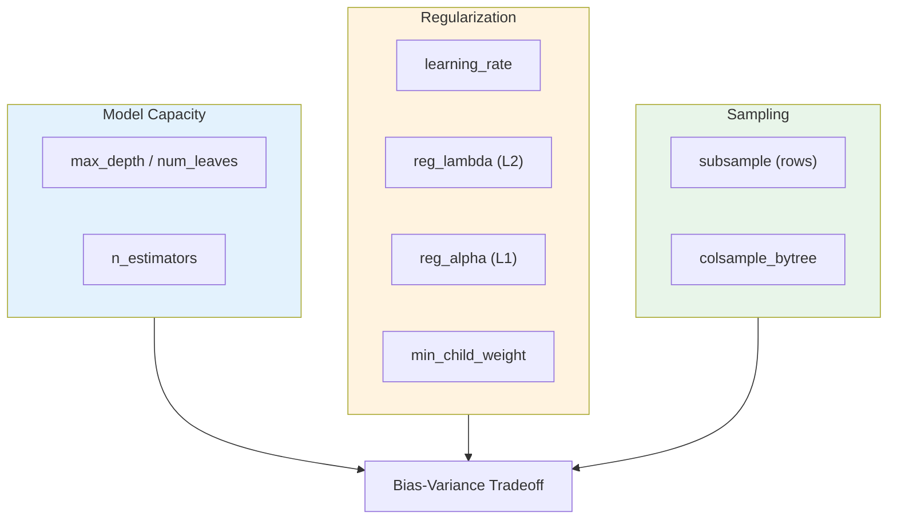

> *"Boosting is based on a simple strategic principle: use a committee of weak prediction rules to produce a powerful predictor."*
> — **Jerome Friedman**, inventor of Gradient Boosting

In February 2016, a Kaggle competition to predict restaurant revenue closed with a familiar result: **XGBoost won**. In March 2016, another competition ended the same way. And April. And May. By mid-2016, XGBoost had become so dominant that Kaggle winners jokingly called it "the algorithm."

This wasn't an accident. Gradient boosting, invented by Jerome Friedman in 1999, represented a fundamental insight: that iteratively correcting errors, rather than training in parallel, could produce extraordinarily powerful models. XGBoost, LightGBM, and CatBoost refined this insight into production-ready systems that dominate tabular data.

This exploration traces the journey from Friedman's original paper through the modern gradient boosting ecosystem—the workhorse algorithms that every applied ML practitioner must master.

> **Related reading**: Gradient boosting builds on decision trees covered in [Classical ML Algorithms](/posts/classical-machine-learning-algorithms/). For the theory behind why it works, see [Statistical Learning Theory](/posts/statistical-learning-theory/).

---

## Chapter I: The Boosting Insight

### AdaBoost and the Ensemble Revolution

In 1995, Freund and Schapire introduced **AdaBoost**, proving theoretically and empirically that combining weak learners could produce strong ones. Their key insight: weight training examples by difficulty—examples the current ensemble gets wrong should be emphasized for the next learner.

AdaBoost showed that a committee of simple models (decision stumps) could match or exceed complex models. But it was limited to classification and used a specific exponential loss.

### Friedman's Generalization

In 1999-2001, Jerome Friedman published two landmark papers that generalized boosting to arbitrary differentiable loss functions via **gradient descent in function space**.

The core idea: at each iteration, fit a new model to the **negative gradient** of the loss function. For squared error, the gradient is simply the residual—the gap between prediction and target.

This insight unified boosting with optimization: each tree is a gradient descent step toward lower loss, but in function space rather than parameter space.



---

## Chapter II: The Mathematics of Gradient Boosting

### Additive Model Formulation

We build an ensemble by summing tree predictions:

$$F_M(x) = \sum_{m=1}^{M} \eta \cdot h_m(x)$$

where $h_m$ is the $m$-th tree and $\eta$ is the learning rate (shrinkage).

### Gradient Descent in Function Space

At iteration $m$, we want to add a tree that most reduces loss:

$$F_m(x) = F_{m-1}(x) + \arg\min_h \sum_{i=1}^n L(y_i, F_{m-1}(x_i) + h(x_i))$$

**Key insight**: This is gradient descent. The optimal direction to reduce loss is the negative gradient:

$$r_{im} = -\left[\frac{\partial L(y_i, F(x_i))}{\partial F(x_i)}\right]_{F=F_{m-1}}$$

We fit tree $h_m$ to these **pseudo-residuals** $r_{im}$.

### Loss-Specific Gradients

| Loss Function | Use Case | Gradient (Residual) |
|--------------|----------|---------------------|
| Squared Error | Regression | $y_i - F(x_i)$ |
| Log Loss | Classification | $y_i - \sigma(F(x_i))$ |
| MAE | Regression | $\text{sign}(y_i - F(x_i))$ |
| Huber | Robust Regression | Mixed |

The same algorithm handles regression, classification, ranking—just change the loss.

### XGBoost's Second-Order Optimization

XGBoost uses a **second-order Taylor expansion** for more efficient optimization:

$$\mathcal{L}^{(m)} \approx \sum_{i=1}^{n}\left[g_i h_m(x_i) + \frac{1}{2}h_i h_m(x_i)^2\right] + \Omega(h_m)$$

where:
- $g_i = \frac{\partial L}{\partial F_{m-1}(x_i)}$ — first derivative (gradient)
- $h_i = \frac{\partial^2 L}{\partial F_{m-1}(x_i)^2}$ — second derivative (Hessian)
- $\Omega(h_m) = \gamma T + \frac{1}{2}\lambda\sum_j w_j^2$ — regularization

Using the Hessian enables Newton-Raphson-style updates that converge faster than pure gradient descent.

---

## Chapter III: The Big Three Implementations

### XGBoost (2014): The Kaggle Champion

Tianqi Chen released XGBoost in 2014, engineering Friedman's algorithm for speed and scale. It became the default for anyone serious about tabular data.

**Key innovations**:

| Feature | What It Does |
|---------|-------------|
| **Regularized objective** | L1/L2 on leaf weights prevents overfitting |
| **Sparsity-aware splits** | Missing values learn optimal default direction |
| **Approximate tree learning** | Weighted quantile sketch for distributed training |
| **Column block structure** | Pre-sorted column storage for parallel split finding |
| **Cache-aware access** | Algorithms designed for CPU cache efficiency |



**When to use**: General-purpose gradient boosting. GPU support. Well-documented. Stable.

### LightGBM (2017): Speed Through Sampling

Microsoft Research introduced LightGBM, which pioneered several algorithmic innovations that made gradient boosting dramatically faster.

**Key innovations**:

| Feature | What It Does |
|---------|-------------|
| **Gradient-Based One-Side Sampling (GOSS)** | Keep high-gradient samples, subsample low-gradient |
| **Exclusive Feature Bundling (EFB)** | Combine mutually exclusive sparse features |
| **Leaf-wise growth** | Grow the leaf with maximum gain (vs. level-wise) |
| **Histogram-based splits** | Bin features → O(#bins) instead of O(#samples) |



**When to use**: Large datasets. High-dimensional data. When speed matters. Handles categoricals natively.

### CatBoost (2017): Categorical Intelligence

Yandex released CatBoost, addressing the perennial challenge of categorical features.

**Key innovations**:

| Feature | What It Does |
|---------|-------------|
| **Ordered Target Statistics** | Prevents target leakage in category encoding |
| **Symmetric trees** | All leaves at same depth → faster inference |
| **Oblivious decision trees** | Same split condition at each level |
| **Permutation-based ordering** | Training order matters for encoding |

**When to use**: High-cardinality categoricals. When you can't feature-engineer. Production inference speed critical.

---

## Chapter IV: The Complete Gradient Boosting Pipeline

### Production Implementation

```python
import numpy as np
import pandas as pd
from sklearn.datasets import fetch_california_housing
from sklearn.model_selection import train_test_split, cross_val_score
from sklearn.metrics import mean_squared_error, mean_absolute_error
import xgboost as xgb
import lightgbm as lgb
from typing import Dict, Tuple, Any
import optuna
optuna.logging.set_verbosity(optuna.logging.WARNING)


class GradientBoostingPipeline:
    """
    Production-grade gradient boosting pipeline with:
    - Automatic hyperparameter tuning
    - Early stopping
    - Feature importance
    - Cross-validation
    """

    def __init__(self, framework: str = 'xgboost', task: str = 'regression'):
        """
        Args:
            framework: 'xgboost', 'lightgbm', or 'catboost'
            task: 'regression' or 'classification'
        """
        self.framework = framework
        self.task = task
        self.model = None
        self.best_params = None

    def _get_optuna_objective(self, X, y, cv_folds: int = 5):
        """Create Optuna objective for hyperparameter tuning."""

        def objective(trial):
            if self.framework == 'xgboost':
                params = {
                    'n_estimators': trial.suggest_int('n_estimators', 100, 1000),
                    'max_depth': trial.suggest_int('max_depth', 3, 10),
                    'learning_rate': trial.suggest_float('learning_rate', 0.01, 0.3, log=True),
                    'subsample': trial.suggest_float('subsample', 0.6, 1.0),
                    'colsample_bytree': trial.suggest_float('colsample_bytree', 0.6, 1.0),
                    'reg_alpha': trial.suggest_float('reg_alpha', 1e-8, 10.0, log=True),
                    'reg_lambda': trial.suggest_float('reg_lambda', 1e-8, 10.0, log=True),
                    'min_child_weight': trial.suggest_int('min_child_weight', 1, 20),
                    'random_state': 42
                }
                model = xgb.XGBRegressor(**params) if self.task == 'regression' else xgb.XGBClassifier(**params)

            elif self.framework == 'lightgbm':
                params = {
                    'n_estimators': trial.suggest_int('n_estimators', 100, 1000),
                    'num_leaves': trial.suggest_int('num_leaves', 20, 150),
                    'learning_rate': trial.suggest_float('learning_rate', 0.01, 0.3, log=True),
                    'subsample': trial.suggest_float('subsample', 0.6, 1.0),
                    'colsample_bytree': trial.suggest_float('colsample_bytree', 0.6, 1.0),
                    'reg_alpha': trial.suggest_float('reg_alpha', 1e-8, 10.0, log=True),
                    'reg_lambda': trial.suggest_float('reg_lambda', 1e-8, 10.0, log=True),
                    'min_child_samples': trial.suggest_int('min_child_samples', 5, 100),
                    'random_state': 42,
                    'verbose': -1
                }
                model = lgb.LGBMRegressor(**params) if self.task == 'regression' else lgb.LGBMClassifier(**params)

            scoring = 'neg_mean_squared_error' if self.task == 'regression' else 'accuracy'
            scores = cross_val_score(model, X, y, cv=cv_folds, scoring=scoring)
            return -scores.mean() if self.task == 'regression' else scores.mean()

        return objective

    def tune_hyperparameters(self, X, y, n_trials: int = 50, cv_folds: int = 5):
        """Find optimal hyperparameters using Optuna."""
        study = optuna.create_study(
            direction='minimize' if self.task == 'regression' else 'maximize'
        )
        study.optimize(
            self._get_optuna_objective(X, y, cv_folds),
            n_trials=n_trials,
            show_progress_bar=True
        )
        self.best_params = study.best_params
        return study.best_params

    def fit(self, X, y, X_val=None, y_val=None, params: Dict = None):
        """Train the model with optional early stopping."""
        params = params or self.best_params or {}
        params['random_state'] = 42

        if self.framework == 'xgboost':
            if self.task == 'regression':
                self.model = xgb.XGBRegressor(**params)
            else:
                self.model = xgb.XGBClassifier(**params)

            if X_val is not None:
                self.model.fit(
                    X, y,
                    eval_set=[(X_val, y_val)],
                    verbose=False
                )
            else:
                self.model.fit(X, y)

        elif self.framework == 'lightgbm':
            params['verbose'] = -1
            if self.task == 'regression':
                self.model = lgb.LGBMRegressor(**params)
            else:
                self.model = lgb.LGBMClassifier(**params)

            if X_val is not None:
                self.model.fit(
                    X, y,
                    eval_set=[(X_val, y_val)]
                )
            else:
                self.model.fit(X, y)

        return self

    def predict(self, X):
        """Generate predictions."""
        return self.model.predict(X)

    def feature_importance(self, feature_names=None) -> pd.DataFrame:
        """Get feature importance scores."""
        importance = self.model.feature_importances_
        names = feature_names or [f'feature_{i}' for i in range(len(importance))]
        return pd.DataFrame({
            'feature': names,
            'importance': importance
        }).sort_values('importance', ascending=False)


# Demonstration
if __name__ == "__main__":
    # Load data
    data = fetch_california_housing()
    X_train, X_test, y_train, y_test = train_test_split(
        data.data, data.target, test_size=0.2, random_state=42
    )
    X_train, X_val, y_train, y_val = train_test_split(
        X_train, y_train, test_size=0.2, random_state=42
    )

    # Compare frameworks
    for framework in ['xgboost', 'lightgbm']:
        print(f"\n{'='*40}")
        print(f"{framework.upper()}")
        print('='*40)

        pipeline = GradientBoostingPipeline(framework=framework, task='regression')

        # Quick hyperparameter tuning (use more trials in production)
        best_params = pipeline.tune_hyperparameters(X_train, y_train, n_trials=20)
        print(f"Best params: {best_params}")

        # Train with early stopping
        pipeline.fit(X_train, y_train, X_val=X_val, y_val=y_val, params=best_params)

        # Evaluate
        y_pred = pipeline.predict(X_test)
        rmse = np.sqrt(mean_squared_error(y_test, y_pred))
        mae = mean_absolute_error(y_test, y_pred)
        print(f"Test RMSE: {rmse:.4f}")
        print(f"Test MAE: {mae:.4f}")

        # Feature importance
        importance = pipeline.feature_importance(data.feature_names)
        print(f"\nTop 3 features:\n{importance.head(3)}")
```

---

## Chapter V: Hyperparameter Tuning Demystified

### The Key Levers



### Parameter Interactions

| Parameter | Effect of Increasing | Typical Range |
|-----------|---------------------|---------------|
| `learning_rate` | Faster training, more overfitting | 0.01–0.3 |
| `n_estimators` | More capacity, slower training | 100–1000+ |
| `max_depth` | More capacity, more overfitting | 3–10 |
| `num_leaves` (LightGBM) | More capacity (should < 2^max_depth) | 20–150 |
| `subsample` | More regularization | 0.6–1.0 |
| `colsample_bytree` | More regularization | 0.6–1.0 |
| `reg_lambda` | More regularization (L2) | 0–10 |
| `min_child_weight` | Prevents overfitting | 1–20 |

### The Learning Rate / Iterations Tradeoff

**Fundamental principle**: Lower learning rate + more iterations = better generalization (given enough compute).

Standard practice:
1. Set `learning_rate = 0.01` or `0.05`
2. Set `n_estimators = 10000`
3. Use early stopping with `early_stopping_rounds = 50`

The model will stop when validation loss stops improving.

---

## Chapter VI: Interpretability with SHAP

### Beyond Feature Importance

Traditional feature importance tells you *which* features matter. SHAP (SHapley Additive exPlanations) tells you *how* each feature affects individual predictions.

```python
import shap
import matplotlib.pyplot as plt

# Train a model
model = xgb.XGBRegressor(n_estimators=100, max_depth=6, random_state=42)
model.fit(X_train, y_train)

# Create SHAP explainer
explainer = shap.TreeExplainer(model)
shap_values = explainer.shap_values(X_test)

# Summary plot: feature importance with direction
shap.summary_plot(shap_values, X_test, feature_names=data.feature_names)

# Dependence plot: how one feature affects predictions
shap.dependence_plot("MedInc", shap_values, X_test, feature_names=data.feature_names)

# Local explanation: why this specific prediction?
idx = 0
shap.force_plot(
    explainer.expected_value,
    shap_values[idx],
    X_test[idx],
    feature_names=data.feature_names
)
```

### Monotonic Constraints

When domain knowledge dictates that a feature should only increase (or decrease) the prediction:

```python
# Higher credit score should NEVER increase default risk
model = xgb.XGBClassifier(
    monotone_constraints={'credit_score': -1}  # Negative: higher value → lower prediction
)

# Higher income should increase loan approval likelihood
model = lgb.LGBMClassifier(
    monotonic_constraints=[1, -1, 0, 0]  # Per-feature constraints
)
```

This is crucial for [Explainable ML](/posts/explainable-ml/) in regulated industries.

---

## Chapter VII: When Not to Use Gradient Boosting

### Gradient Boosting Weaknesses

| Scenario | Why It Struggles | Better Alternative |
|----------|------------------|-------------------|
| Images | No spatial invariance | CNNs |
| Text/sequences | No sequential structure | Transformers |
| Very small data | Overfits easily | Linear models, Bayesian |
| Real-time training | Sequential algorithm | Online learning |
| Very high-dimensional sparse | Many useless features | Linear models, neural sparse |

### The Deep Learning Question

For tabular data, gradient boosting often beats neural networks. A [2022 benchmark paper](https://arxiv.org/abs/2207.08815) found XGBoost/LightGBM matched or exceeded deep learning on most tabular datasets—with less tuning.

When might neural networks win on tabular data?
- Very large datasets (>1M rows)
- Complex feature interactions that benefit from embeddings
- Mixed modality (tabular + text/images)
- When combined with boosting in ensembles

---

## Chapter VIII: Production Considerations

### Speed Comparison

| Framework | 100K rows, 100 features | Notes |
|-----------|------------------------|-------|
| XGBoost (CPU) | ~60 seconds | Solid default |
| XGBoost (GPU) | ~8 seconds | NVIDIA GPU required |
| LightGBM | ~15 seconds | Fastest CPU implementation |
| CatBoost | ~45 seconds | Fastest inference after training |

### Serving at Scale

For real-time inference:
1. Export model in native format (not pickle)
2. Use framework's predict API (optimized C++)
3. Consider model compression (fewer trees, lower depth)
4. Batch predictions when possible

For batch inference:
1. Use distributed training (XGBoost on Spark, LightGBM on Dask)
2. Parallelize prediction across chunks
3. Cache models in memory across workers

---

## References and Further Exploration

### Foundational Papers
- Friedman, "Greedy Function Approximation: A Gradient Boosting Machine" (2001) — [Original GBM paper](https://statweb.stanford.edu/~jhf/ftp/trebst.pdf)
- Friedman, "Stochastic Gradient Boosting" (2002)
- Chen & Guestrin, "XGBoost: A Scalable Tree Boosting System" (KDD 2016) — [Paper](https://arxiv.org/abs/1603.02754)
- Ke et al., "LightGBM" (NeurIPS 2017)
- Prokhorenkova et al., "CatBoost: Unbiased Boosting with Categorical Features" (NeurIPS 2018)

### Practical Resources
- [XGBoost Documentation](https://xgboost.readthedocs.io/)
- [LightGBM Documentation](https://lightgbm.readthedocs.io/)
- [SHAP Documentation](https://shap.readthedocs.io/)
- Optuna for hyperparameter optimization

### Related Posts
- [Classical ML Algorithms](/posts/classical-machine-learning-algorithms/) — Decision trees and random forests
- [Statistical Learning Theory](/posts/statistical-learning-theory/) — Why regularization works
- [Explainable ML](/posts/explainable-ml/) — SHAP and feature importance in depth

---

*Jerome Friedman invented gradient boosting in 1999. For twenty-five years, it has remained the algorithm of choice for structured data—through the deep learning revolution, through Kaggle's evolution, through the rise of AutoML. XGBoost, LightGBM, and CatBoost are not flashy. They don't attract the headlines that transformers do. But when you need to ship a model that works on tabular data, these are the algorithms you reach for. That's the highest compliment in applied ML: boring and effective.*
