> *"Randomized Controlled Trials are the gold standard of causal inference, but in the real world, the standard is often impossible to meet. That's where design comes in."*

Standard A/B testing—randomizing users to treatment and control buckets—is the bread and butter of data science. But what happens when you can't randomize users? What if your product is a two-sided marketplace like Uber or Airbnb? What if network effects bleed treatment into control?

This post dives beyond the basics into **advanced experimental designs** required for complex ecosystems: Cluster Randomization, Switchback Testing, and Crossover Designs.

> **Related reading**: This builds on statistical foundations from [A/B Testing Statistics](/posts/ab-testing-statistics/) and sets the stage for causal inference discussed in [Instrumental Variables](/posts/instrumental-variables/).

---

## Chapter I: The Limits of User-Level Randomization

### The SUTVA Violation
The Stable Unit Treatment Value Assumption (SUTVA) states that one user's treatment assignment should not affect another user's outcome.

In social networks or marketplaces, this breaks:
- **Network Effects**: If I get a new chat feature, my friends (in control) are affected because I message them more.
- **Marketplace Interference**: If I give 50% of drivers a bonus, they work more, lowering prices/wait times for *everyone* (including control group riders).

### The Consequence
When SUTVA is violated, standard A/B tests yield **biased estimates** of the Average Treatment Effect (ATE). You might measure a lift that disappears at full launch, or miss a negative spillover effect entirely.

---

## Chapter II: Cluster Randomization

When individual randomization leaks interference, randomize groups (clusters) instead.

### The Design
Instead of randomizing users, we randomize:
- **Geographies**: City A gets features, City B doesn't.
- **Communities**: Subreddit A gets a moderation tool, Subreddit B doesn't.
- **Classrooms/Schools**: For EdTech products.

### The Math: Inflation Factor
Clustering treats a group of $N$ users as a single unit, drastically reducing effective sample size. The variance inflation is given by the **Design Effect**:

$$DE = 1 + (m-1)\rho$$

Where:
- $m$: Average cluster size
- $\rho$: Intra-class correlation (ICC)

The effective sample size becomes:
$$N_{eff} = \frac{N}{1 + (m-1)\rho}$$

Even a small ICC ($0.01$) with large clusters ($m=1000$) increases variance by $11x$, requiring $11x$ more data.

```python
def calculate_design_effect(cluster_size, icc):
    """Calculates inflation variance due to clustering."""
    return 1 + (cluster_size - 1) * icc

# Example: School-based randomization
m = 500  # students per school
rho = 0.05 # students in same school are similar
de = calculate_design_effect(m, rho)
print(f"Variance Inflation: {de:.2f}x")
# Variance Inflation: 25.95x
```

---

## Chapter III: Switchback (Time-Split) Testing

For marketplaces (Uber/Lyft/DoorDash), geographical randomization is too coarse (few cities) and user randomization leaks supply/demand effects. Only **Time** remains.

### The Design
Switch between Treatment and Control periodically within the same geography.
- **Window**: 160 min Treatment -> 160 min Control -> Repeat.
- **Randomization**: Randomize the sequence (e.g., T-C-C-T-C-T).

### Challenges
1. **Carryover Effects**: Treatment effect lingers. If a driver bonus attracts more drivers at 2 PM (Treatment), they might stay online at 3 PM (Control), polluting the control window.
   - *Solution*: **Burn-out periods**. Discard data from the first 15 mins after a switch.
2. **Periodicity**: Demand varies by hour.
   - *Solution*: Stratified randomization to ensure equal T/C coverage across peak/off-peak times.

```mermaid
gantt
    title Switchback Design with Burn-in
    dateFormat HH:mm
    axisFormat %H:%M

    section City A
    Treatment (A) :a1, 08:00, 2h
    Burn-in       :crit, 10:00, 15m
    Control (B)   :after a1, 2h
    Burn-in       :crit, 12:15, 15m
    Treatment (A) :after a1, 2h
```



---

## Chapter IV: Crossover Designs

In a Crossover design, each subject serves as their own control.

### The Design
- Period 1: User A gets Treatment, User B gets Control.
- Period 2: User A gets Control, User B gets Treatment.

### The Estimator
We compare $\Delta_A = (Y_{A,T} - Y_{A,C})$ and $\Delta_B = (Y_{B,T} - Y_{B,C})$.

$$ATE = \frac{1}{2} E[(\bar{Y}_{T1} - \bar{Y}_{C1}) + (\bar{Y}_{T2} - \bar{Y}_{C2})]$$

This removes **between-subject variance**, massively increasing power.

**Risk**: As with Switchback, carryover effects are the enemy. Crossover is rare in high-velocity tech products but gold standard in medicine and low-frequency B2B tools.

---

## Chapter V: Variance Reduction (CUPED)

Regardless of design, high variance kills statistical power. **CUPED** (Controlled-Experiment Using Pre-Experiment Data) is the industry standard for variance reduction.

### The Intuition
Users who buy a lot today probably bought a lot yesterday. We can use pre-experiment data (covariates) to predict the outcome and test on the *residuals*.

### The Math
Instead of comparing means of metric $Y$, we compare:

$$Y'_{i} = Y_{i} - \theta (X_{i} - \bar{X})$$

Where $X_i$ is the pre-experiment value of the metric. The optimal $\theta$ is:

$$\theta = \frac{Cov(Y, X)}{Var(X)}$$

The variance of $Y'$ is reduced by:
$$Var(Y') = Var(Y) (1 - \rho^2)$$
where $\rho$ is the correlation between pre- and post-values. Even moderate correlation ($0.5$) reduces variance by $25\%$, equal to increasing sample size by $33\%$.

### Implementation

```python
import numpy as np
import pandas as pd

def apply_cuped(df, metric_col, pre_metric_col):
    """
    Applies CUPED transformation to reduce variance.

    Args:
        df: DataFrame containing experiment data
        metric_col: The target metric (Y)
        pre_metric_col: The pre-experiment value (X)

    Returns:
        Series with CUPED-adjusted metric
    """
    covariance = np.cov(df[metric_col], df[pre_metric_col])[0, 1]
    variance = np.var(df[pre_metric_col])
    theta = covariance / variance

    mean_pre = df[pre_metric_col].mean()

    # Y_cuped = Y - theta * (X - mean(X))
    df['cuped_metric'] = df[metric_col] - theta * (df[pre_metric_col] - mean_pre)

    return df['cuped_metric']

# Variance reduction demo
np.random.seed(42)
n = 10000
pre_clicks = np.random.lognormal(0, 1, n)
# Post is correlated with Pre
clicks = pre_clicks * 1.5 + np.random.normal(0, 0.5, n)

df = pd.DataFrame({'clicks': clicks, 'pre_clicks': pre_clicks})
df['cuped'] = apply_cuped(df, 'clicks', 'pre_clicks')

std_original = df['clicks'].std()
std_cuped = df['cuped'].std()
reduction = 1 - (std_cuped**2 / std_original**2)

print(f"Variance reduction: {reduction:.1%}")
# Variance reduction: ~80-90% typically if correlation is high
```

---

## Chapter VI: When A/B Testing Fails

Sometimes, no design works.

1. **Long-term effects**: Short tests optimize for clicks (vanity) but kill retention (value).
   - *Solution*: Holdout groups (1% of users held out for 6 months).
2. **Novelty Effects**: Users click because it's new.
   - *Solution*: Run test longer; look at "learning curve" of effect size.
3. **Primacy Effects**: Users hate change (initially).
   - *Solution*: Ignore first week data.

### Synthetic Control
When you launch a TV ad or a nationwide change, you have N=1 treated unit (the country).
We build a **Synthetic Control**—a weighted combination of other countries/regions that mimics the treated unit's pre-trend perfectly.

$$J(\mathbf{W}) = || \mathbf{X}_1 - \mathbf{X}_0 \mathbf{W} ||^2$$

Subject to $\sum w_i = 1$. The difference between the treated unit and the synthetic unit post-launch is the causal effect.

---

## Summary

Choosing the right design is often more important than the analysis itself.

| Scenario | Recommended Design |
|----------|-------------------|
| Standard Product | **User-Randomized** (A/B Test) |
| Social Feature | **Cluster Randomization** (Graph Cluster) |
| Ride-Sharing / Delivery | **Switchback** (Time-Split) |
| B2B / SaaS | **Crossover** or **Matched Pair** |
| High Variance Metric | **CUPED** adjustment |
| Nationwide Launch | **Synthetic Control** / **Geo-Lift** |

> *"The best time to think about variance is before you start the experiment."*
