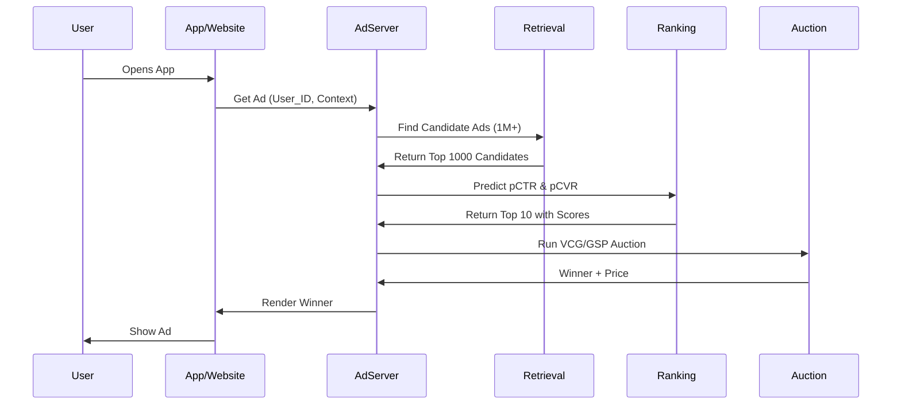

> *"In the milliseconds it takes your page to load, a global auction happens. Millions of advertisers compete for your attention, and one winner emerges. This is the most sophisticated real-time market in human history."*

Ad Tech is often misunderstood as just "marketing." In reality, it is high-frequency trading for attention.
The engineering constraints are brutal:
1. **Latency**: You have <100ms to respond.
2. **Throughput**: 1M+ queries per second (QPS).
3. **Data**: Petabytes of user logs per day.

This post dissects the architecture of a modern Ad Delivery System (like Google Ads or Meta Ads).

> **Related reading**: This is the system that executes the [Incremental ROAS](/posts/incrementality-testing-at-scale/) strategy.

---

## Chapter I: The Ecosystem Overview

When you visit a website (Publisher), the following happens:
1. **SSP (Supply Side Platform)**: Represents the Publisher. "I have a slot available."
2. **Ad Exchange**: The marketplace.
3. **DSP (Demand Side Platform)**: Represents the Advertiser. "I want to buy users who like shoes."

In Walled Gardens (Facebook/Google), these three are collapsed into one monolithic system.



---

## Chapter II: The 4-Stage Funnel

We cannot score 100 million ads for every request. We use a **Cascade Architecture**.

### 1. Retrieval (Matching)
**Goal**: Reduce 100M ads → 1,000 candidates.
**Tech**: Inverted Index (Elasticsearch/Lucene) or Vector Search (FAISS/ScaNN).

Query: "User likes *Running* AND *Tech* AND Loc=*NYC*"
Returns: All active campaigns targeting these keys.

### 2. Light Ranking (Filtering)
**Goal**: Reduce 1,000 → 100.
**Logic**: Hard constraints.
- Budget exhausted?
- Brand safety rules? (Don't show gambling ads on kids' content)
- Frequency cap reached? (User saw this ad 5 times today)

### 3. Heavy Ranking (Scoring)
**Goal**: Score top 100.
**Model**: Deep Neural Networks (DLRM).
The core equation for **eCPM (Expected Cost Per Mille)**:

$$eCPM = Bid \times pCTR \times pCVR \times 1000$$

- **pCTR**: Probability of Click (Logistic Regression / GBM)
- **pCVR**: Probability of Conversion (Deep Learning)

### 4. The Auction
**Goal**: Pick 1 winner.
**Mechanism**: Generalized Second Price (GSP) or VCG.

---

## Chapter III: The VCG Auction

Why not just pay what you bid? (First-Price).
Because advertisers would "shade" their bids (bid \$1.01 if the next guy bids \$1.00).

In **Second-Price Auctions (Vickrey-Clarke-Groves)**, you pay the **opportunity cost** you imposed on others.

**Scenario**: 1 Slot.
- Bidder A: Bids \$10.
- Bidder B: Bids \$5.

**Outcome**:
- A wins.
- A pays \$5.01 (just enough to beat B).

**Benefit**: Truthful bidding is the dominant strategy. You bid your true value, because bidding higher doesn't increase your price (only win rate), and bidding lower risks losing a profitable impression.

---

## Chapter IV: The Ranking Model (DLRM)

The heart of the system is the **pCTR model**.
Meta open-sourced **DLRM (Deep Learning Recommendation Model)**.

### Architecture
1. **Dense Features**: Age, Time of Day (Feed into MLP).
2. **Sparse Features**: UserID, AdID, Keywords (Feed into Embedding Tables).
3. **Interaction**: Dot product of embeddings.
4. **Top MLP**: Sigmoid output for probability.

```python
import torch
import torch.nn as nn

class SimpleDLRM(nn.Module):
    def __init__(self, num_users, num_items, embed_dim=16):
        super().__init__()
        # Embeddings for sparse features
        self.user_emb = nn.Embedding(num_users, embed_dim)
        self.item_emb = nn.Embedding(num_items, embed_dim)

        # MLP for dense features interaction
        self.fc = nn.Sequential(
            nn.Linear(embed_dim * 2, 64),
            nn.ReLU(),
            nn.Linear(64, 1),
            nn.Sigmoid()
        )

    def forward(self, user_ids, item_ids):
        u = self.user_emb(user_ids)
        i = self.item_emb(item_ids)

        # Concat interaction
        x = torch.cat([u, i], dim=1)
        return self.fc(x)

# Millions of parameters, trained on billions of logs
model = SimpleDLRM(num_users=100000, num_items=50000)
```

**Challenge**: Embeddings are huge (TB sizes). Ad systems require **Model Parallelism** (splitting embeddings across GPUs) rather than just Data Parallelism.

---

## Chapter V: Pacing and Budgeting

If I have a \$100/day budget, I shouldn't spend it all at 8 AM.
The **Pacing Controller** throttles the bid.

$$Bid_{sharded} = Bid_{value} \times \psi(t)$$
where $\psi(t) \in [0, 1]$ is the pacing multiplier.

We use **PID Controllers** (Proportional-Integral-Derivative) to adjust $\psi$ in real-time.
- Spending too fast? Drop $\psi$.
- Spending too slow? Raise $\psi$.

See [Online Bid Optimization](/posts/online-bid-optimization/) for the control theory details.

---

## Summary

Ad systems are the Formula 1 of engineering. They combine:
- **Search Systems** (Retrieval)
- **Recommender Systems** (Ranking)
- **Game Theory** (Auctions)
- **Control Theory** (Pacing)
- **Distributed Systems** (Low latency)

If you can build an ad server, you can build almost anything.

> *"Latency is the silent killer of revenue."*
