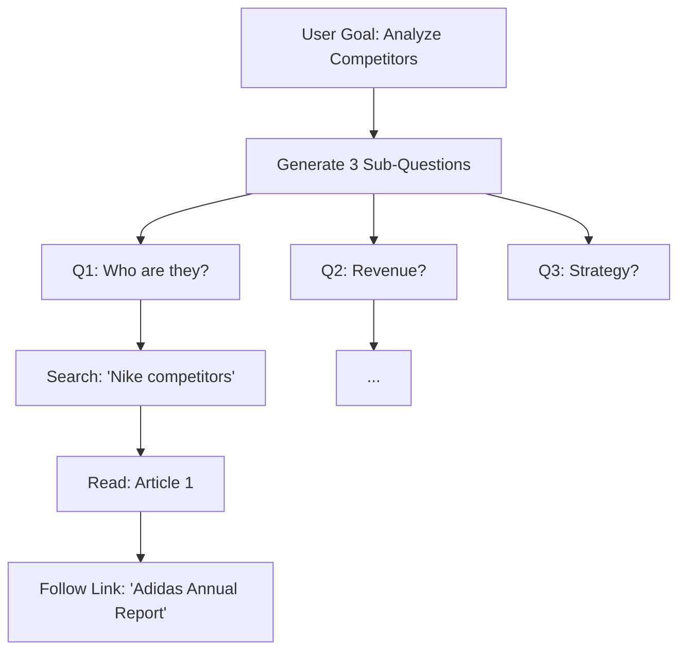

> *"An LLM knows what it was trained on. A Research Agent knows what was published 5 minutes ago."*

Standard RAG (Retrieval-Augmented Generation) is brittle. It fetches the top-3 snippets and prays the answer is there.
**Deep Research Agents** (like OpenAI's Deep Research or Perplexity Pro) go further. They act like a human analyst:
1. They plan a search strategy.
2. They read multiple sources.
3. They follow links recursively.
4. They synthesize a report with citations.

This post explores the architecture of autonomous information gathering.

> **Related reading**: Builds on [The Era of AI Agents](/posts/the-era-of-ai-agents/) by applying it to the specific domain of knowledge discovery.

---

## Chapter I: The Breadth vs Depth Trade-off

A research agent must balance:
- **Breadth**: How many disparate queries to run? ("competitors to Nike", "Nike financial reports", "Nike recent scandals")
- **Depth**: How deep to click? (Search Result -> Landing Page -> PDF Report -> Footnote).

### The Recursive Algorithm
Most research agents use a **DFS (Depth-First Search)** approach with a "satisfaction" stopping condition.



---

## Chapter II: The Architecture of Synthesis

Reading is easy. Writing is hard.
How do you combine 10,000 words of scraped text into a 500-word cohesive summary?

**Map-Reduce Summarization**:
1. **Map**: Summarize each individual document into key facts relevant to the query.
2. **Cluster**: Group facts by theme (e.g., "Financials", "Product", "Legal").
3. **Reduce**: Write a paragraph for each theme.

This avoids the "Lost in the Middle" phenomenon where LLMs forget the middle of a long context window.

---

## Chapter III: Citation and Verification

The cardinal sin of research is hallucination.
Research Agents must enforce **Citation Tracking**.

Every sentence in the final output must be back-traceable to a Source ID.
- **Bad**: "Revenue grew 20%."
- **Good**: "Revenue grew 20% [Source: 10-K Report, Page 45]."

**Implementation Tip**: Force the model to generate XML tags `<cite id="1">` immediately after facts.

---

## Chapter IV: Building a Toy Research Agent

```python
import time

class ResearchAgent:
    def __init__(self, topic):
        self.topic = topic
        self.knowledge_base = []

    def step_1_plan(self):
        print(f"Planning research for: {self.topic}")
        # Mock LLM call to generating queries
        return [f"{self.topic} history", f"{self.topic} recent news"]

    def step_2_execute(self, queries):
        for q in queries:
            print(f"Searching: {q}...")
            # Mock Search API
            results = [{"title": f"Article about {q}", "url": "http://example.com"}]

            for res in results:
                print(f"  Reading: {res['title']}")
                # Mock Scraper
                content = f"Important fact about {q} found in {res['url']}"
                self.knowledge_base.append(content)

    def step_3_synthesize(self):
        print("\nSynthesizing Report...")
        full_context = "\n".join(self.knowledge_base)
        # Mock LLM Summarization
        report = f"## Report on {self.topic}\nBased on {len(self.knowledge_base)} sources:\n"
        for fact in self.knowledge_base:
            report += f"- {fact}\n"
        return report

agent = ResearchAgent("Quantum Computing")
queries = agent.step_1_plan()
agent.step_2_execute(queries)
print(agent.step_3_synthesize())
```

---

## Chapter V: Use Cases in Advertising

Why does an Ad Tech engineer care?
**Creative Strategy**.

Instead of guessing what ads to write, a Research Agent can:
1. "Scan all competitor ads for 'Running Shoes' in the last month."
2. "Identify the top 3 value propositions used (e.g., 'Comfort' vs 'Speed')."
3. "Find 1-star reviews on Amazon to identify user pain points."
4. "Propose 5 new ad angles based on gaps."

This turns "Deep Research" into "High-Converting Copy".

---

## Summary

Deep Research Agents automate the top of the funnel (Strategy).
They don't just find links; they **synthesize knowledge**.
The next generation of CEOs will have a fleet of these agents reading the entire internet every morning.

> *"Knowledge is power. Synthesis is leverage."*
---
title: "Deep Research Agents: Automating Literature Review and Synthesis"
date: 2025-12-01
categories:
  - Artificial Intelligence
  - Machine Learning
tags:
  - agentic-ai
  - llm
  - research-agents
  - rag
---
